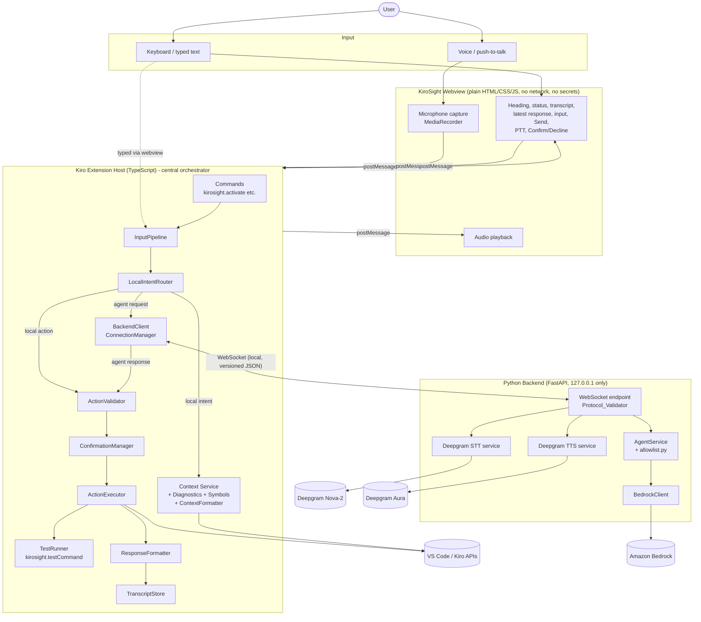
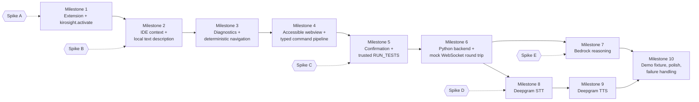
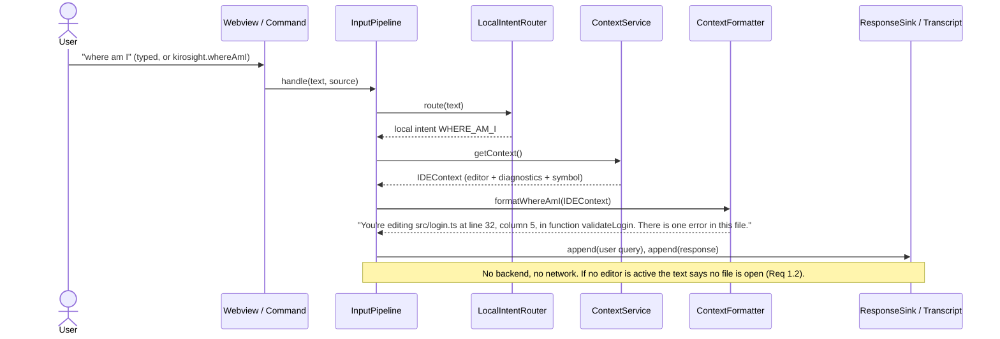
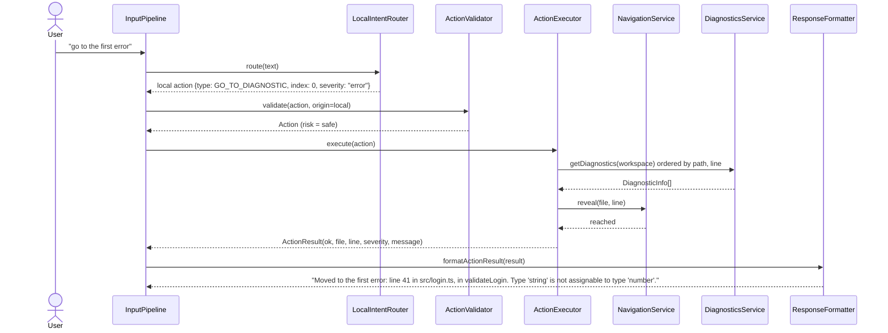
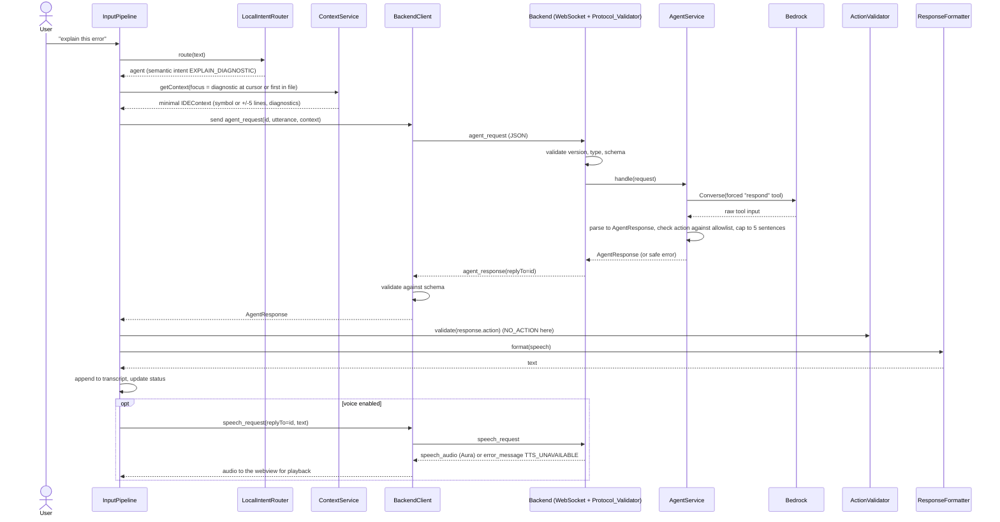
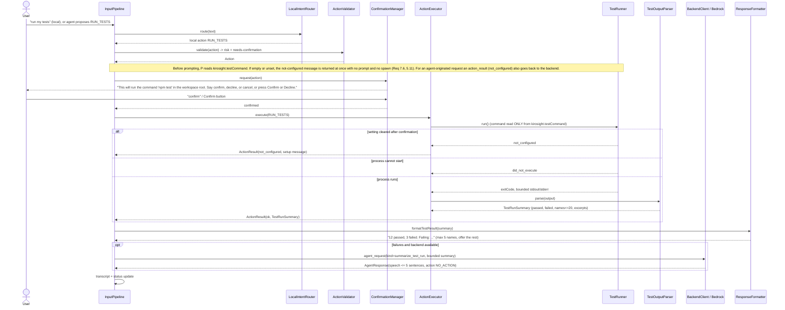
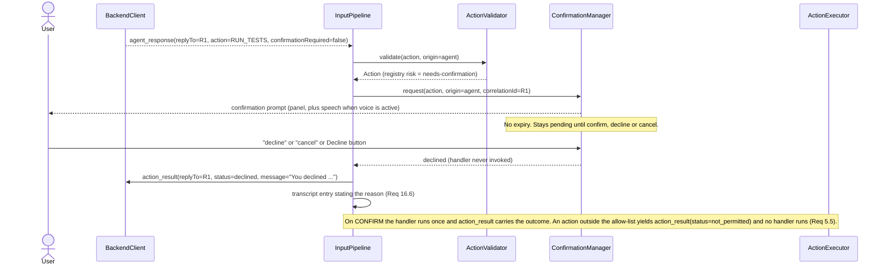
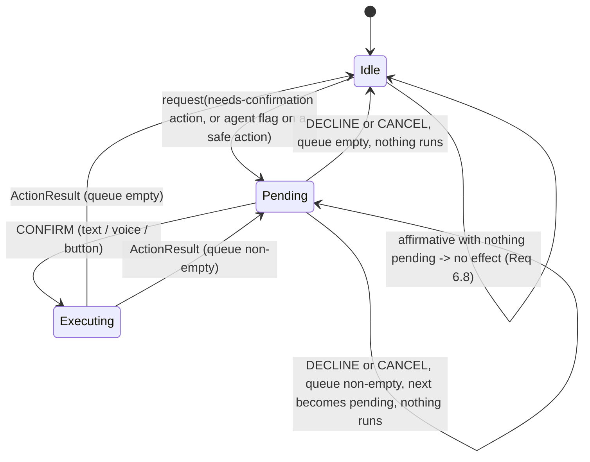
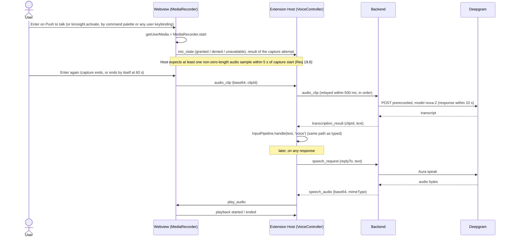

# Design Document: KiroSight MVP

## Overview

KiroSight is a voice- and text-driven accessibility agent for blind and low-vision developers using Kiro. It supplements the developer's screen reader by answering questions about IDE state ("where am I?", "what errors are there?"), navigating ("go to the first error"), explaining code and errors, and running the project's tests under an allow-list and confirmation model.

### Design priorities (in order)

1. **Hackathon reliability.** A narrow flow that always works beats broad flows that sometimes work. Every external dependency (backend, Bedrock, Deepgram, microphone) is optional at runtime.
2. **Incremental implementation.** Each milestone is demoable on its own and lists the earlier milestones it depends on. The first two milestones need no Python, no WebSocket, no Bedrock, and no Deepgram.
3. **Accessibility.** Typed text is the baseline input. Voice is a major KiroSight feature but is additive. A text transcript always exists. No state is conveyed by color alone.
4. **Clear security boundaries.** The extension host is the only component that touches the IDE and the only component that executes actions. The webview holds no secrets and has no network access. The backend holds the provider credentials and binds to loopback only.
5. **Deterministic functionality before AI/voice.** Simple commands are recognized and executed locally by a deterministic router. Bedrock is only used for semantic reasoning.
6. **Voice must never block the demo.** Voice is a headline feature, but a failure of microphone capture or Deepgram must never block the rest of the demo. The fallback order is: voice interaction, then typed command interaction, then the deterministic local accessibility features (context, diagnostics, navigation, tests), which stay usable regardless. If webview microphone capture proves unreliable in the early spike (as defined by Req 19.6), the extension is not redesigned around voice. The text pipeline is preserved as is, and the backend-local `VoiceInput` implementation, which Req 19.6 to 19.8 fully support, is swapped in behind the `VoiceInput` interface.

### Key design decisions

| # | Decision | Rationale |
|---|---|---|
| D1 | The TypeScript extension host is the central orchestrator. | It is the only process with IDE access (`tech.md`). Everything else is a service it calls. |
| D2 | One `InputPipeline` handles all input (typed, transcribed voice, confirmation replies). | Requirements 8.1, 8.2 and 9.2 require typed and voice input to share one path. One path means one place to test. |
| D3 | The webview is "dumb": the extension host owns the transcript, status and confirmation state and pushes a view model to the webview. | Webview code is hard to unit test and runs in a restricted context. Keeping decisions in the host keeps logic Vitest-testable and keeps the webview free of secrets (Req 19). |
| D4 | Local-first routing with a deterministic `LocalIntentRouter`; anything not confidently recognized goes to the backend. | Keeps Milestones 1 to 5 and the core demo path independent of Bedrock and Deepgram. |
| D5 | The extension's action registry (`actions/allowlist.ts`) is authoritative at execution time. The backend's `allowlist.py` is the auditable source for what the agent may propose. Both are checked against one committed parity fixture file. | The extension is the only executor (Req 5), but Req 5.1 fixes the registry location at `backend/app/allowlist.py`. Req 5.1 as amended describes exactly this dual registry: the same Actions and risk classes on both sides, verified by an automated parity check, with the Action_Dispatcher consulting only the extension-side copy. |
| D6 | Confirmation is decided by the extension-side action risk registry, never by the agent's `confirmationRequired` flag. The flag may make an operation stricter (ask for confirmation on a `safe` action) but must never bypass or weaken extension-side confirmation. A `needs-confirmation` action is confirmed even when the flag is `false` or absent (Req 5.9). A `safe` action with the flag `true` is also confirmed (Req 5.10). A `safe` action with the flag `false` or absent runs without confirmation (Req 5.2). | Req 5.1 and 5.3 make the registry the source of truth. The model is untrusted. See conflict C2 and Property 2. |
| D7 | `RUN_TESTS` uses `child_process.spawn` with output capture, not a terminal. | Terminal shell integration is not reliable enough to parse output. Spawn gives exit codes, bounded buffers, timeouts and cancellation. |
| D8 | Bedrock is called through the Converse API with one forced "respond" tool whose input schema is `AgentResponse`, and the result is validated again with Pydantic. | Forced tool use raises the rate of schema-conforming output. Validation is still mandatory because the model is untrusted. |
| D9 | Hackathon voice input uses complete-clip STT (record until the user ends capture or 60 s elapse, send once) instead of streaming. | Avoids streaming audio through `postMessage`. Upgrade path exists. See conflict C6 and the risk register. |
| D10 | The extension requests TTS explicitly with a `speech_request` message after it has shown the response text. | Local responses need TTS too. Text is always shown first (Req 15.3). |
| D11 | Microphone capture sits behind a `VoiceInput` interface with two fully supported implementations: `WebviewVoiceInput` (preferred) and `BackendLocalVoiceInput`. Only `voice/` knows which one is active. | Current evidence says webview `getUserMedia` is probably blocked in VS Code-family webviews (see R2 and Spike D). Req 19.6 to 19.8 define when the backend-local implementation is used and require that both implementations feed the same intent-handling path. Isolating capture behind one interface means a capture change cannot affect command routing, confirmation or accessibility logic. |
| D12 | Runtime validation uses `zod` (pinned) on the TypeScript side and Pydantic v2 (`extra="forbid"`) on the Python side. No schema code generation. | Type annotations do not validate at runtime (`tech.md`). Zod is quick to write and keeps shapes flat and explicit. |
| D13 | The local WebSocket rejects any connection carrying an `Origin` header and supports an optional shared token. | A browser page could otherwise connect to `ws://127.0.0.1` and reach the backend. See Security. |
| D14 | While an action awaits confirmation, the only accepted intents are CONFIRM, DECLINE, CANCEL and REPEAT_CONFIRMATION. Everything else gets a re-prompt of at most 30 words and is routed nowhere. A pending confirmation never expires. | Req 6.6, 6.9 and 6.10 fix exactly these four replies, the 30-word re-prompt and the no-expiry rule. No unrelated utterance reaches the `LocalIntentRouter` rules or Bedrock while a confirmation is pending, and an idle affirmative has no effect (Req 6.8). Read-only questions during a pending confirmation are post-MVP (Requirements Non-Goals). |
| D15 | `kirosight.activate` is the canonical activation mechanism and works with no keybinding at all (Req 9.7). The `Ctrl+Alt+K` default for Windows and Linux is included in the manifest if and only if Spike A finds it unbound in the default Kiro/VS Code keybindings and in every extension installed on the demo machine (Req 9.8). If Spike A finds a conflict, no default keybinding ships on any platform (Req 9.9). No macOS default exists (Req 9.10). | Keybinding conflicts and AltGr layouts are real (R7). The command palette and user keybindings must always work. |
| D16 | `GO_TO_SYMBOL` is not in the MVP allow-list. Req 4.6 and 4.7 cover going to a line only, and Req 5.8 fixes the allow-list at eight actions with no `GO_TO_SYMBOL` and no `RUN_COMMAND`. `SymbolService` remains for internal use (current function, explanation context). | The amended requirements and the Non-Goals section define symbol navigation as out of scope. See conflict C12 (resolved) and Stretch features. |

### Conflicts with the brief and how they were resolved

Steering and the approved requirements win. Each deviation from the brief is listed here. Rows marked RESOLVED were open conflicts until `requirements.md` was amended (Requirements 4, 5, 6, 9, 10 and 19, plus the Introduction, Glossary and Non-Goals). They are kept for history. No conflict between this design and the current `requirements.md` remains open.

| # | Brief said | Steering / requirements say | Resolution |
|---|---|---|---|
| C1 | Backend files `protocol.py`, `agent.py`, `bedrock_service.py`, `deepgram_service.py`. `localIntentRouter.ts` under `commands/`. | `structure.md`: `backend/app/protocol/`, `agent/`, `speech/`, `allowlist.py`. `commands/` must stay thin. Req 13.2: Bedrock interface in `backend/app/agent/`. | Backend uses the steering packages. `bedrock_service.py` lives in `agent/`, `deepgram_service.py` in `speech/`. The router lives in `extension/src/intent/`. `session.py` stays at `app/session.py`. |
| C2 | `AgentResponse.confirmationRequired` decides confirmation. | Req 5.1/5.3: confirmation follows the Allowlist_Registry risk class. | The registry decides. The flag is advisory and can only add a confirmation. |
| C3 | Webview contains only heading, status, transcript, latest response, input, Send, Push-to-Talk. | Req 6.2 and 14.1 require confirmation controls in the panel. | **Explicitly approved deviation.** Confirm and Decline controls are added. They are rendered only while a confirmation is pending. |
| C4 | Initial actions exclude symbol navigation. | Req 4.6 and 4.7 are now line-only, and Req 5.8 fixes the allow-list at exactly eight actions. | **RESOLVED by the amended requirements.** The brief and the requirements agree. `GO_TO_SYMBOL` and `RUN_COMMAND` are not in the allow-list, and generic passthroughs remain excluded. See C12. |
| C5 | Not stated. | Req 7.3 says report up to 20 failing names. Req 16.3 says the summary lists up to 5. | Two layers. `TestRunSummary` and the `ActionResult` carry up to 20 names. The spoken/summary text lists up to 5 and offers the full list. |
| C6 | Not stated. `tech.md` says STT is "streaming". | Req 9.1 does not require streaming. | Default is complete-clip STT. Streaming is a documented later upgrade. |
| C7 | Not stated. | Req 19.1 made webview capture the preferred path. Req 19.6 to 19.8 (added by the amendment) allow a backend-local `VoiceInput` when webview capture is unreliable. | **RESOLVED by the amended requirements (Req 19.1, 19.6, 19.7, 19.8).** `WebviewVoiceInput` is preferred. `BackendLocalVoiceInput` is a fully supported implementation behind the `VoiceInput` interface. It is selected if Spike D finds webview capture unreliable as Req 19.6 defines it. Text from either implementation enters the same intent-handling path, and credentials stay out of the webview and the extension source (see Risks R2). |
| C8 | Example output "You're editing src/login.ts at line 32." | Req 1.1 requires reporting the column too. | Output includes the column: "You're editing src/login.ts at line 32, column 5." |
| C9 | Not stated. | Req 2.1 orders reports by severity, path, line. Req 4.4 orders navigation by path, line. | Two comparators: `compareForReport` and `compareForNavigation`. |
| C10 | `AgentResponse.speech` goes to Aura automatically. | Req 15.3: text must be shown no later than audio onset. | `agent_response` is delivered first. The extension then sends `speech_request`. |
| C11 | Protocol types include `IDEContext`, `UserUtterance`, `ActionRequest`. | Req 11.1: every message has `version` and `type`. | `IDEContext` and `UserUtterance` are payload types embedded in `agent_request`. `ActionRequest` is a top-level message reserved for backend-initiated proposals. Additional top-level messages are needed for audio, handshake and cancel. |
| C12 | Not stated. The user decided the MVP has no voice-driven symbol navigation. | The earlier Req 4.6 and 4.7 covered going to a line or a symbol. | **RESOLVED by the amended requirements (Req 4.6, 4.7, 5.8 and the Non-Goals section).** Req 4.6 and 4.7 are line-only, and the allow-list is exactly eight actions. The MVP implements `GO_TO_LINE` only. `GO_TO_SYMBOL` is absent from the allow-list, router, validator, protocol and tests, and the task list must not include a `GO_TO_SYMBOL` implementation task. An utterance such as "go to function foo" is unrecognized local input and falls back to the agent. The agent cannot propose a symbol navigation action because an unknown action is rejected with `not_permitted`. |
| C13 | Not stated. The user decided pending-confirmation handling is minimal. | The earlier Req 6 named only confirm and decline. | **RESOLVED by the amended requirements (Req 6.5, 6.6, 6.9, 6.10).** While an action is pending the design accepts exactly CONFIRM, DECLINE, CANCEL and REPEAT_CONFIRMATION. CANCEL behaves exactly like DECLINE (Req 6.5). REPEAT_CONFIRMATION re-presents the prompt and leaves the queue unchanged (Req 6.9). Other input gets a re-prompt of at most 30 words (Req 6.6), and the pending action has no automatic expiry (Req 6.10). Read-only questions during a pending confirmation are post-MVP (Requirements Non-Goals). |
| C14 | Not stated. The user decided no macOS default keybinding for the MVP. | The earlier Req 9.7 stated a Ctrl+Alt+K default unconditionally. | **RESOLVED by the amended requirements (Req 9.7, 9.8, 9.9, 9.10).** `kirosight.activate` is primary and works with no keybinding (Req 9.7). The `Ctrl+Alt+K` default for Windows and Linux is included if and only if the Spike A conflict check finds it unbound in the default Kiro/VS Code keybindings and in every extension installed on the demo machine (Req 9.8). If the check finds a conflict, no default keybinding ships on any platform (Req 9.9). No macOS default exists (Req 9.10). |

## Architecture

### System diagram



The diagram follows the brief: keyboard input and voice input both end up at the extension host, Routing produces an Agent Request, and the WebSocket client is the only path to the Python backend. Typed text physically originates in the webview text field and reaches the host through `postMessage`. The command-palette entries and any user-assigned keybinding reach the host directly through the same registered commands. Both land in the same `InputPipeline`.

### Trust boundaries

| Boundary | Rule |
|---|---|
| Webview to extension host | `postMessage` only. The host validates every webview message with the bridge validators and discards any message whose `type` is not in the defined webview-to-host set, without relaying it and without acting on it (Req 19.10). The webview CSP has no `connect-src`, so the webview cannot open network connections (Req 19.3). No host-to-webview message carries a credential (Req 19.4). |
| Extension host to backend | One WebSocket owned by `BackendClient` (Req 19.2). Every message is validated on receipt by `protocol/validators.ts`. Backend-proposed actions are re-validated by `ActionValidator` before anything runs. |
| Backend to providers | Only the backend holds Deepgram and Bedrock credentials (environment variables). |
| Agent to IDE | None directly. The agent can only return a proposed `Action`. The extension validates, confirms (if the registry says so) and executes. |
| Secrets | Not in source, not in the webview, not in logs. The extension only stores an optional backend auth token in `SecretStorage`. |

### Incremental build path



Milestones 1 to 5 are extension-only. The first implementation milestone that satisfies the brief's "no external dependencies" requirement is **Milestone 2**: a Kiro command, `ContextService`, `ContextFormatter`, and a text response. It uses a `ResponseSink` that writes to a VS Code `OutputChannel` and a notification, so there is no dependency on the webview, Python, WebSocket, Bedrock or Deepgram. Milestone 1 contains a brief scaffold step (repository layout, strict TypeScript, Vitest and fast-check, `.gitignore`, `.env.example`). The full list, with dependencies and demo outcomes, is in Recommended Implementation Order. The spikes are described in Early Technical Spikes.

### Sequence 1: "Where am I?" (entirely local)



### Sequence 2: "Go to the first error" (entirely local)



If no diagnostic matches, the result is `status: "failed"` with "No matching diagnostic was found" and the cursor does not move (Req 4.5).

### Sequence 3: "Explain this error" (extension, backend, Bedrock)



Failure branches are in the failure-mode table. In short: backend offline, Bedrock failure and invalid model output each produce a stated, accessible error in the transcript. No action runs. The `agent_request` is relayed within 500 ms of receipt and the reply is relayed to the webview within 500 ms (Req 19.5). "Explain this error" is an agent-route request. The local-first relay rules in the InputPipeline section apply when the socket is closed (Req 19.9).

### Sequence 4: "Run my tests"



While the confirmation is pending, only CONFIRM, DECLINE, CANCEL and REPEAT_CONFIRMATION are accepted. DECLINE and CANCEL both clear the pending state and nothing runs. REPEAT_CONFIRMATION re-reads the prompt and changes no state. Any other utterance gets the re-prompt "Run tests is waiting for confirmation. Say confirm, decline, or cancel." (at most 30 words, naming the pending action and listing the accepted replies) and is routed nowhere (not to the `LocalIntentRouter` rules and not to Bedrock). Nothing runs until an explicit confirmation arrives, and the pending confirmation never expires on its own (Req 5.4, 6.10).

### Sequence 5: Agent-proposed action that the user declines



Every agent-originated action ends in exactly one `action_result` sent back to the backend: `ok`, `failed`, `declined` (decline, cancel or dismissal), `not_permitted`, `needs_clarification` or `not_configured`. Actions that originate locally (typed or spoken commands handled by the local router) produce no `action_result` message, because nothing is relayed for them.

## Components and Interfaces

### Repository layout

```
KiroSight/
├── .kiro/{steering,specs}/
├── docs/                       # protocol.md (message reference), env-vars.md, demo-script.md,
│                               # spike-results.md (planned; records Spike A-E outcomes; not yet created)
├── extension/
│   ├── package.json            # commands (primary), optional replaceable keybinding, configuration, restrictedConfigurations
│   ├── tsconfig.json           # "strict": true
│   ├── vitest.config.ts
│   ├── media/
│   │   ├── main.js             # thin DOM wiring only, plain JS
│   │   └── styles.css
│   ├── src/
│   │   ├── extension.ts                    # activate(): wire services, register commands
│   │   ├── commands/registerCommands.ts    # thin: command id -> pipeline/webview
│   │   ├── intent/{localIntentRouter.ts, normalize.ts, intentTypes.ts}
│   │   ├── pipeline/{inputPipeline.ts, requestTracker.ts}
│   │   ├── context/{contextService.ts, diagnosticsService.ts, symbolService.ts,
│   │   │            contextFormatter.ts, contextWindow.ts, editorAdapter.ts}
│   │   ├── actions/{actionTypes.ts, allowlist.ts, actionValidator.ts,
│   │   │            actionExecutor.ts, actionResult.ts}
│   │   ├── confirmation/{confirmationManager.ts, replyClassifier.ts}
│   │   ├── navigation/{navigationService.ts, fileService.ts, diagnosticNavigation.ts}
│   │   ├── testing/{testRunner.ts, testOutputParser.ts, testCommandConfig.ts}
│   │   ├── response/{responseFormatter.ts, responseSink.ts}
│   │   ├── transcript/transcriptStore.ts
│   │   ├── backend/{backendClient.ts, connectionManager.ts, backendLauncher.ts}
│   │   ├── protocol/{messages.ts, validators.ts, constants.ts, bridgeMessages.ts}
│   │   ├── voice/{voiceController.ts, audioRelay.ts, voiceInput.ts,
│   │   │          webviewVoiceInput.ts, backendLocalVoiceInput.ts}
│   │   ├── webview/{webviewProvider.ts, viewModel.ts, html.ts}
│   │   └── util/{result.ts, redact.ts, logger.ts}
│   └── test/                   # Vitest + fast-check, mirrors src/
└── backend/
    ├── app/
    │   ├── __init__.py
    │   ├── main.py             # FastAPI app, /health, /ws (127.0.0.1 default)
    │   ├── config.py           # env loading, loopback enforcement, credential checks
    │   ├── session.py          # per-connection state: history, in-flight requests, cancel
    │   ├── allowlist.py        # single source of truth: action -> risk, params
    │   ├── logging_utils.py    # redaction
    │   ├── protocol/{__init__.py, messages.py, validators.py}
    │   ├── agent/{__init__.py, agent_service.py, llm_client.py,
    │   │          bedrock_service.py, prompt.py, response_parser.py}
    │   └── speech/{__init__.py, deepgram_service.py, local_recorder.py}
    ├── tests/
    ├── requirements.txt
    └── .env.example
```

Rules carried over from steering: one concern per module, `commands/` stays thin, pure logic is kept free of `vscode` imports so Vitest can test it.

### The vscode seam

Every module that needs the IDE goes through a small adapter interface, so the deterministic logic can be tested without an extension host.

```ts
// context/editorAdapter.ts
export interface EditorSnapshot {
  workspaceName: string | null;
  rootCount: number;
  file: { fsPath: string; relativePath: string; languageId: string; lineCount: number } | null;
  cursor: { line: number; column: number } | null;          // 1-indexed
  selection: { start: Pos; end: Pos } | null;               // 1-indexed, null when empty
  getLines(startLine: number, endLine: number): string[];   // 1-indexed, inclusive
}
export interface EditorAdapter {
  snapshot(): EditorSnapshot | null;                        // null => no text editor active
  allDiagnostics(): RawDiagnostic[];                        // from vscode.languages.getDiagnostics()
  documentSymbols(fsPath: string): Promise<SymbolQueryResult>;
  reveal(fsPath: string, pos: Pos): Promise<void>;
  openFile(fsPath: string): Promise<void>;
  findFiles(name: string): Promise<string[]>;               // workspace-relative matches
  focusEditor(): Promise<void>;
}
```

`VscodeEditorAdapter` is the only implementation that imports `vscode`. Tests use an in-memory fake.

### InputPipeline (single processing path)

```ts
export type InputSource = 'typed' | 'voice' | 'command';

export interface InputPipeline {
  handle(text: string, source: InputSource): Promise<void>;   // typed and transcribed voice both call this
  confirm(): Promise<void>;                                   // keyboard/button confirmation
  decline(): Promise<void>;                                   // button; same effect as a spoken or typed CANCEL
  interrupt(): void;                                          // stop speech, cancel in-flight work
}
```

`handle` behaves as follows, in this order:

1. If `text.trim()` is empty, discard it. Nothing is appended to the transcript and nothing is routed (Req 8.4).
2. Append the user entry to the transcript (Req 15.1).
3. If a confirmation is pending, send the text to `ConfirmationManager.handleReply` and stop. Only CONFIRM, DECLINE, CANCEL and REPEAT_CONFIRMATION are acted on. Any other text produces the concise re-prompt and is never passed to `LocalIntentRouter.route` and never sent to the backend or Bedrock (Req 6.6, 6.8).
4. Otherwise call `LocalIntentRouter.route(text)`.
5. A local result is executed through the `ContextService`, `ActionValidator`/`ActionExecutor` and `ResponseFormatter`.
6. An agent result is the only case in which typed text leaves the host. The pipeline builds a bounded `IDEContext`, relays `agent_request` through `BackendClient` within 500 ms of receipt and in arrival order, and validates the reply. If the WebSocket is not open, nothing is relayed, the host sends the webview `backend_unavailable` within 2 s, and the submitted text stays in the input field (see Local-first relay and Failure Modes).
7. Append the response (Req 15.2), update status, and start TTS only after the text is shown (Req 15.3).

The `source` value changes only how the response is presented (speech or not). It never changes routing, so the same text produces the same intent and response content for `typed` and `voice` (Req 8.2).

#### Local-first relay (Req 19.5, 19.9)

The host relays to the backend only two things: captured audio, and typed text that the deterministic local routing cannot handle (the `agent` route). Typed commands handled by the local routing (Requirements 1, 2, 4, 6 and 7: context, diagnostics, navigation, confirmation replies and `RUN_TESTS`) are processed locally by the host, are never relayed, and work with no backend running.

| Case | Host behavior |
|---|---|
| Local route (any backend state) | Handled in-process. Nothing is sent to the backend. The webview receives `submit_ack` with status `handled`. |
| Agent route or audio, WebSocket open | Relayed within 500 ms of receipt, in the order received. Each backend response is relayed to the webview within 500 ms of receipt (Req 19.5). `submit_ack` (`handled`) is sent once the request has been relayed. |
| Agent route or audio, WebSocket not open | Nothing is relayed. Within 2 s the host sends the webview `backend_unavailable` (Req 19.9). The `submit_ack` status is `not_handled`, so the webview leaves the typed text in the input field for resubmission. |
| Empty or whitespace-only text | Discarded (Req 8.4). `submit_ack` status `discarded`. |

The webview clears its input field only when it receives `submit_ack` with status `handled`. This keeps typed text available after a backend failure (Req 19.9) and after a voice failure (Req 10.1).

`RequestTracker` assigns a monotonically increasing lane id to every agent, STT and TTS request. A reply whose `replyTo` is not the current request is dropped. This gives "latest utterance wins" and supports interruption.

### LocalIntentRouter

```ts
export type LocalIntent =
  | { kind: 'WHERE_AM_I' }
  | { kind: 'CURRENT_SYMBOL' }                                   // "read the current function"
  | { kind: 'READ_SELECTION' }
  | { kind: 'DESCRIBE_DIAGNOSTICS'; scope: 'file' | 'workspace' }
  | { kind: 'ACTION'; action: Action }                           // next/previous/go to error or line/open file/focus/run tests
  | { kind: 'SUMMARIZE_LAST_TEST_RUN' }
  | { kind: 'HELP' };

export type RouteResult =
  | { route: 'local'; intent: LocalIntent }
  | { route: 'agent'; reason: 'semantic' | 'unrecognized' | 'ambiguous'; hint?: AgentHint };

export function route(utterance: string): RouteResult;           // pure, synchronous, no I/O
```

How it decides:

- **Normalize.** Lowercase, trim, strip punctuation, collapse whitespace, drop leading filler ("please", "can you", "could you", "kirosight"), map digit words one to twenty to digits.
- **Rule table.** Each rule is an anchored pattern over the whole normalized utterance with typed parameter capture. Partial matches do not count, so "go to the error in auth and fix it" does not match "go to the error".
- **Exactly-one rule.** If exactly one rule matches, route locally. If zero match, route to the agent as `unrecognized`. If two or more rules yield different intents, route to the agent as `ambiguous`.
- **Semantic phrases go to the agent.** Patterns starting with "explain", "why", "what does", "how do", "summarize" (except "summarize the test failures" with a stored run) are routed as `semantic`.
- **No side effects.** The router neither reads the IDE nor the clock. Its result depends only on the string. It is a pure function, which also makes it property-testable.

Initial rule table:

| Utterance (normalized) | Result |
|---|---|
| where am i / what file am i in / what file is this | `WHERE_AM_I` |
| what function am i in / read the current function / current function | `CURRENT_SYMBOL` |
| read the selection / read selection | `READ_SELECTION` |
| what errors are there / list errors / what problems are there | `DESCRIBE_DIAGNOSTICS` (`workspace`) |
| what errors are in this file / errors in this file | `DESCRIBE_DIAGNOSTICS` (`file`) |
| next error / next problem | `NEXT_DIAGNOSTIC` (`severity: error`) |
| previous error / previous problem | `PREVIOUS_DIAGNOSTIC` (`severity: error`) |
| go to the first / second / third error (ordinal n) | `GO_TO_DIAGNOSTIC` (`index: n-1`, `severity: error`) |
| go to line N / line N | `GO_TO_LINE` (`line: N`) |
| open NAME (file-like token) | `OPEN_FILE` (`path: NAME`) |
| focus editor / back to editor | `FOCUS_EDITOR` |
| run my tests / run tests / run the tests | `RUN_TESTS` |
| summarize the test failures | `SUMMARIZE_LAST_TEST_RUN` (agent if a run exists, local message otherwise) |
| help / what can you do | `HELP` |

Notes:

- "last error" is ambiguous between "the last diagnostic" and "previous error", so it is intentionally not in the table and falls back to the agent.
- There is no symbol-navigation rule. An utterance such as "go to function foo" or "go to symbol foo" matches no rule, so it routes to the agent as `unrecognized`. The agent cannot answer it with a navigation action, because any action outside the allow-list is rejected (see Stretch features and conflict C12). `CURRENT_SYMBOL` ("read the current function") stays because it only describes code and does not move the cursor.
- The router is never consulted while a confirmation is pending (see ConfirmationManager).

### Context subsystem

`ContextService` builds an `IDEContext` (see Data Models). It is split so the parts that need `vscode` are thin:

| Module | Responsibility | Pure? |
|---|---|---|
| `editorAdapter.ts` | Reads editor, cursor, selection, lines, diagnostics via `vscode.window` and `vscode.languages.getDiagnostics` | No (only adapter touching `vscode`) |
| `symbolService.ts` | Calls `vscode.executeDocumentSymbolProvider`, flattens results to `SymbolNode[]`, and `findEnclosingSymbol(nodes, pos)` picks the innermost match | Lookup is pure |
| `diagnosticsService.ts` | Maps raw diagnostics to `DiagnosticInfo`, filters by scope, sorts with `compareForReport` / `compareForNavigation` | Pure |
| `contextWindow.ts` | `selectExcerpt(...)` implements the context-window strategy | Pure |
| `contextFormatter.ts` | Turns `IDEContext` / `DiagnosticInfo[]` into concise text | Pure |
| `contextService.ts` | Orchestrates the above and returns `IDEContext` | Thin |

#### Context-window strategy

Nothing sends whole files (Req 12, `security.md`). The excerpt is chosen in this order:

1. **Selection.** If the selection is non-empty, use the selected lines.
2. **Current symbol.** Else if an enclosing symbol is found, use the symbol's lines.
3. **Cursor window.** Else use `CURSOR_WINDOW_RADIUS` lines on each side of the cursor line, clamped to the document.

When the chosen range exceeds limits, it is cut down around an anchor and `truncated: true` is set.

| Constant | Value | Purpose |
|---|---|---|
| `MAX_EXCERPT_LINES` | 80 | Hard upper bound on excerpt lines |
| `MAX_EXCERPT_CHARS` | 6000 | Hard upper bound on excerpt characters |
| `CURSOR_WINDOW_RADIUS` | 10 | Lines each side of the cursor for the fallback window |
| `DIAGNOSTIC_WINDOW_RADIUS` | 5 | Lines each side when explaining a diagnostic without a resolvable symbol (Req 12.1) |
| `MAX_DIAGNOSTICS_SENT` | 25 | Most severe first, then navigation order; the total count is still reported |
| `MAX_DIAGNOSTIC_MESSAGE_CHARS` | 500 | Per-message cap |

Anchor for truncation: the diagnostic line when explaining a diagnostic, else the cursor line, else the selection start. The retained range always includes the anchor line when the anchor is inside the original range.

For "explain this error", the excerpt is the enclosing symbol of the diagnostic's line if resolvable, otherwise `DIAGNOSTIC_WINDOW_RADIUS` lines around the diagnostic line (Req 12.1). Diagnostics travel in their own structured field, separate from the excerpt text.

#### Symbol provider unavailable

`SymbolService` is used internally only: describing the current function or class, reading the current function, and selecting relevant context for explanations. It is not used to move the cursor in the MVP. `SymbolQueryResult` is `{status:'found', nodes} | {status:'none_enclosing'} | {status:'provider_unavailable'}`. The service retries once after a short delay (default 1500 ms total budget) because language servers can be slow to start. If still unavailable, the context carries `symbolStatus: 'provider_unavailable'`, the excerpt falls back to the cursor window, and the formatter says no enclosing symbol was found (Req 1.4). It never guesses a symbol by text heuristics.

### Action system

```ts
// actions/actionTypes.ts
export type Severity = 'error' | 'warning' | 'any';

export type Action =
  | { type: 'NO_ACTION' }
  | { type: 'GO_TO_DIAGNOSTIC'; index: number; severity?: Severity }   // 0-based index in navigation order
  | { type: 'NEXT_DIAGNOSTIC'; severity?: Severity }
  | { type: 'PREVIOUS_DIAGNOSTIC'; severity?: Severity }
  | { type: 'OPEN_FILE'; path: string }                                // name or workspace-relative path
  | { type: 'GO_TO_LINE'; line: number }                               // 1-indexed
  | { type: 'FOCUS_EDITOR' }
  | { type: 'RUN_TESTS' };                                             // no parameters, ever
```

There is no `RUN_COMMAND`, no `command`/`cmd`/`shell` field on any action, and no generic `executeCommand` passthrough (Req 4.8, 5.6, 5.7). **Ordinal mapping (documented once).** Users speak and read 1-based ordinals ("first", "second", "the third error"). The wire field `GO_TO_DIAGNOSTIC.index` is 0-based. The router maps ordinal n to `index = n - 1`, and every message shown to users converts back to a 1-based ordinal. The candidate list that `index` refers to is built from the diagnostics the Diagnostics_Service reports, restricted to the severity named in the request if one is named, and ordered by ascending file path then ascending line number. The sort is stable, so diagnostics with the same path and line keep the order the Diagnostics_Service reported them in (Req 4.4). `severity` defaults to `'error'` for the phrase "first error". If no errors exist but warnings do, the result message says so rather than silently jumping to a warning.

```ts
// actions/allowlist.ts  (mirrors backend/app/allowlist.py)
export type Risk = 'safe' | 'needs-confirmation';
export const ALLOWLIST: Readonly<Record<Action['type'], { risk: Risk }>> = {
  NO_ACTION: { risk: 'safe' },
  GO_TO_DIAGNOSTIC: { risk: 'safe' },
  NEXT_DIAGNOSTIC: { risk: 'safe' },
  PREVIOUS_DIAGNOSTIC: { risk: 'safe' },
  OPEN_FILE: { risk: 'safe' },
  GO_TO_LINE: { risk: 'safe' },
  FOCUS_EDITOR: { risk: 'safe' },
  RUN_TESTS: { risk: 'needs-confirmation' },
};
```

The initial allow-list is exactly eight actions: `NO_ACTION`, `GO_TO_DIAGNOSTIC`, `NEXT_DIAGNOSTIC`, `PREVIOUS_DIAGNOSTIC`, `OPEN_FILE`, `GO_TO_LINE`, `FOCUS_EDITOR` and `RUN_TESTS`. Navigation actions move the cursor or the active editor but never change file contents or run code, so they are `safe`. `RUN_TESTS` executes a shell command, so it is `needs-confirmation`. The `Record<Action['type'], ...>` type makes the compiler fail if an action is added without a risk class.

**Parity with the backend (Req 5.1).** The dual registry is `backend/app/allowlist.py` (what the agent may request) plus `actions/allowlist.ts` (what the Action_Dispatcher consults at execution time). A committed fixture `protocol/fixtures/allowlist.json` (action name, risk, parameter names) is read by a Vitest test against `ALLOWLIST` and by a pytest test against `allowlist.py`, which is the automated parity check Req 5.1 requires. This is a hand-maintained fixture, not code generation.

#### ActionValidator

```ts
export type ValidationResult =
  | { ok: true; action: Action; risk: Risk }
  | { ok: false; code: 'UNKNOWN_ACTION' | 'INVALID_PARAMS'; message: string };

export function validateAction(raw: unknown, origin: 'local' | 'agent'): ValidationResult;
```

- `type` must exactly equal (case-sensitive) a key of `ALLOWLIST`, else `UNKNOWN_ACTION` (Req 5.2, 5.3, 5.5). `go_to_line` and `Go_To_Line` are unknown.
- Parameters are checked per action with strict schemas. Unknown or extra properties are rejected, so `{type:'RUN_TESTS', command:'rm -rf'}` fails. Req 5.7 says an Action request that carries command text, arguments or modifications MAY be rejected as malformed, and this rejection is how the design uses that allowance. The executed test command is never affected by anything in an Action request (Req 5.6, 5.7).
- On the wire, `agent_response.action` is typed only as an object with a string `type`. The strict per-action check happens here, so an unknown action reaches the validator and produces a `not_permitted` `action_result` for the agent instead of being dropped as a malformed envelope.
- Bounds: `line` is a positive safe integer, `index` is a non-negative safe integer, `path` and `name` are non-empty, length-capped, with no NUL characters.
- The same validator runs for local and agent origins, so nothing bypasses it.
- `validateAction` returns the risk class from the extension-side registry. Callers must use that value to decide on confirmation. The agent's `confirmationRequired` flag is read only by the pipeline and may add a confirmation to a `safe` action. It can never remove or skip the confirmation of a `needs-confirmation` action, and it is not an input to `validateAction` (Property 2).
- Near-miss and removed names such as `GO_TO_SYMBOL` and `RUN_COMMAND` return `UNKNOWN_ACTION`.

#### ActionExecutor

`ActionExecutor` holds a handler map typed as `{ [K in Action['type']]: (a: Extract<Action, {type: K}>) => Promise<ActionResult> }`. The compiler enforces one named handler per action. Handlers call `NavigationService`, `FileService` or `TestRunner`. There is no code path that passes a string to `vscode.commands.executeCommand`.

Behavior per handler:

| Action | Behavior |
|---|---|
| `GO_TO_DIAGNOSTIC` | Resolve `index` against the candidate list (filtered by `severity`, stable-sorted by `compareForNavigation`, see the ordinal mapping above). Open the file if it is not active, move the cursor to the start of the diagnostic's line, and return file, line, severity and message. No match: `failed` with "no matching diagnostic was found", cursor and active editor unchanged (Req 4.4, 4.5). |
| `NEXT_DIAGNOSTIC` / `PREVIOUS_DIAGNOSTIC` | Pure `diagnosticNavigation.next/previous(sorted, cursor)`. Strictly after/before the cursor position. Wraps at the ends and says so. The wrap-around is a design-level behavior consistent with Req 4.4. Requirement 4 does not require it, so traceability cites 4.4 only. |
| `OPEN_FILE` | `FileService.resolve(nameOrPath)` accepts a file name or a workspace-relative path. 0 matches: `failed` "file not found". 1 match: open it and report its workspace-relative path. More than 1 match for a name: `needs_clarification` listing up to 10 workspace-relative paths plus the total match count when it exceeds 10. On no match or ambiguity nothing opens and the active editor is unchanged (Req 4.1 to 4.3). Never opens an arbitrary match. |
| `GO_TO_LINE` | Valid only when an editor is active and the requested line is an integer N with `1 <= N <= lastLine`. The cursor moves to the start of that line (column 1) and the result reports file path and line. Otherwise `failed` "the requested location could not be found", cursor and active editor unchanged (Req 4.6, 4.7). |
| `FOCUS_EDITOR` | Focuses the active text editor if one exists. |
| `RUN_TESTS` | Delegates to `TestRunner` (below). The not-configured check runs first and returns `not_configured` with no prompt and no spawn (Req 5.11, 7.6). |
| `NO_ACTION` | Returns `ok` with no side effects. |

Every navigation failure (no match, ambiguous match, no editor, out-of-range line) leaves the active editor and cursor exactly as they were.

```ts
export interface ActionResult {
  actionType: Action['type'];
  status: 'ok' | 'failed' | 'declined' | 'not_permitted' | 'needs_clarification' | 'not_configured';
  message: string;                       // concrete outcome or reason (Req 16.5, 16.6)
  details?:
    | { kind: 'file_opened'; relativePath: string }
    | { kind: 'diagnostic_reached'; relativePath: string; line: number; severity: string; message: string; symbol?: string }
    | { kind: 'location_reached'; relativePath: string; line: number }
    | { kind: 'ambiguous_files'; matches: string[]; totalMatches: number }   // matches has at most 10 entries
    | { kind: 'test_run'; summary: TestRunSummary };
}
```

### ConfirmationManager

A small, pure state machine plus a UI callback. It is deliberately simple. It holds at most one pending action and a FIFO queue of held requests. The registry risk class decides whether a request enters this state machine at all; the agent's `confirmationRequired` flag can only add an entry for a `safe` action and can never remove or skip one for a `needs-confirmation` action.



**Accepted intents while pending.** Exactly four: CONFIRM, DECLINE, CANCEL and REPEAT_CONFIRMATION.

- `replyClassifier.classify(text)` returns `'confirm' | 'decline' | 'cancel' | 'repeat' | 'unrecognized'` using a small, documented set of normalized phrases (for example: confirm, yes, go ahead, approve; decline, no; cancel, stop, never mind; repeat, say that again, what is waiting). It matches only whole normalized utterances. Anything else is `unrecognized`. It is deterministic and depends only on the string.
- CONFIRM executes exactly the pending action. DECLINE and CANCEL both clear the pending state and nothing runs, and the result is reported as a decline with the reason "you declined" or "you cancelled". REPEAT_CONFIRMATION re-reads the stored prompt text and changes no state.
- Any other utterance, including a valid command such as "go to line 10" or a question such as "what errors are there", is never routed to the `LocalIntentRouter` rules and never sent to Bedrock while a confirmation is pending. The manager answers with a concise re-prompt built from the pending action's label, for example "Run tests is waiting for confirmation. Say confirm, decline, or cancel." The pending action stays pending.
- Arbitrary read-only questions during a pending confirmation are a post-MVP enhancement (see Stretch features).
- Keyboard confirmation calls `confirm()` or `decline()` from the webview buttons. They produce the same transitions as spoken or typed text (CONFIRM and DECLINE).
- The confirmation prompt is built by `ResponseFormatter.formatConfirmation(action, target)` and must contain the action name, the concrete target and the accepted replies. For `RUN_TESTS` the target is the exact command string from `kirosight.testCommand` (Req 6.1, 7.1). The re-prompt is built by `ResponseFormatter.formatConfirmationReprompt(action)`.
- The manager stores the resolved target at request time. It executes exactly what was shown. If the setting changes while pending, the stored command is discarded and the user is re-prompted.
- **No expiry.** There is no timer anywhere in the manager. A pending action leaves the pending state only through CONFIRM, DECLINE or CANCEL (Req 5.4, 6.10). Closing or hiding the panel does not resolve it. `kirosight.activate` reopens the panel with the prompt shown again, and the Decline control and the CANCEL reply are the dismissal routes.
- **Re-prompt format.** `ResponseFormatter.formatConfirmationReprompt(action)` returns at most 30 words, names the pending action and lists the accepted replies (Req 6.6).
- **FIFO hold queue.** A `needs-confirmation` request that arrives while another is pending is appended to a FIFO queue and is presented only after the pending one is confirmed, declined or cancelled, in the order received. At most one action is presented as pending at a time (Req 6.7). REPEAT_CONFIRMATION re-presents the current prompt and leaves the pending action and the queue order unchanged (Req 6.9).
- **Idle affirmative.** With nothing pending, "yes", "ok" or "just do it" is classified as unrecognized input for confirmation purposes. It executes nothing and is not stored, so a later request that enters the pending state still needs its own explicit CONFIRM (Req 6.8).
- **Agent-originated requests.** The manager records the origin and the correlation id (the `replyTo` of the `agent_response` or the `id` of the `action_request`). On DECLINE, CANCEL or dismissal it reports `declined` with the reason, and the pipeline sends an `action_result` to the backend (Req 5.4, see Sequence 5).
- **Flag semantics (Req 5.9, 5.10).** A `needs-confirmation` action always enters the manager, whatever `confirmationRequired` says. A `safe` action enters it only when `confirmationRequired` is `true`.

### TestRunner

```ts
export type TestRunOutcome =
  | 'passed' | 'failed'                 // process ran and runner output was understood
  | 'completed_unparsed'                // process ran, exit code known, counts not understood
  | 'did_not_execute'                   // spawn error, command not found (Req 7.7)
  | 'timed_out' | 'cancelled' | 'not_configured';

export interface TestRunSummary {
  outcome: TestRunOutcome;
  command: string;                      // the configured command, echoed back to the user
  exitCode: number | null;
  passed: number | null;
  failed: number | null;
  totalFailedNames: number;             // true count even if names list is capped
  failingTests: FailingTest[];          // at most 20 (Req 7.3)
  outputTruncated: boolean;
  durationMs: number;
}
export interface FailingTest { name: string; messageExcerpt?: string }   // excerpt <= 300 chars
```

**Command source.** `testCommandConfig.read()` returns the trimmed value of `kirosight.testCommand` from `vscode.workspace.getConfiguration`. It takes no parameters that could come from the agent or from a user utterance. If the value is empty or whitespace the runner returns `not_configured` without spawning, and the message tells the user to set `kirosight.testCommand` (for example `npm test`) in settings (Req 7.6). The same response applies to user-initiated and agent-initiated `RUN_TESTS`. In the agent case the pipeline also sends it to the backend as an `action_result` with status `not_configured` (Req 5.11). The check happens before any confirmation prompt is shown.

**Workspace trust.** The setting can be supplied by a repository's `.vscode/settings.json`. That makes an untrusted repository a route to arbitrary command execution. Two mitigations:

- `package.json` declares `kirosight.testCommand` under `capabilities.untrustedWorkspaces.restrictedConfigurations`, so VS Code ignores it in untrusted workspaces.
- The confirmation prompt always shows the exact command.

**Execution strategy.**

- `child_process.spawn(command, { shell: true, cwd: <first workspace folder>, windowsHide: true })`. `shell: true` is needed so strings such as `npm test` or `npm run test -- --ci` work. The string comes only from trusted configuration.
- stdout and stderr are merged into a bounded buffer (keeping the head and tail, 256 KB total). Overflow sets `outputTruncated`.
- Default timeout 300 s, configurable through `kirosight.testTimeoutSeconds`. On timeout or `interrupt()`, kill the process tree (`taskkill /T /F` on Windows, process-group kill elsewhere).
- Full output is also written to a `KiroSight Tests` output channel. That gives the user a path to read everything with their screen reader (Req 7.4, 16.4) without KiroSight speaking it.
- Only one run at a time. A second request while one is running returns a stated message.
- VS Code Test Explorer is not used (Req 7.8).

**Parsing** (`testOutputParser.ts`, pure). Best-effort, format-specific extractors tried in order: Jest, Vitest, pytest, Mocha, then a generic fallback. Each extractor returns counts and failing names when it recognizes its summary line. If nothing matches, the outcome is `completed_unparsed` and the message reports exit code only, without guessing counts. Failing-test message excerpts are truncated and passed through `redact()` (common key/token patterns) before they can go to Bedrock.

**Distinguishing failures to execute from failing tests (Req 7.7).** `did_not_execute` is used when `spawn` emits an error, or when the shell reports command-not-found (exit 127 on POSIX, or the Windows "is not recognized" message with no runner output). A non-zero exit with recognized runner output is `failed`.

**Bedrock summarization (optional).** When failures exist and the backend is available, the extension sends `agent_request(kind='summarize_test_run')` carrying the bounded `TestRunSummary` (counts, up to 20 names, excerpts capped at about 4000 characters total). Raw output never leaves the machine. If the backend is unavailable, the deterministic text from the formatter is the final answer.

### ResponseFormatter

Pure functions that shape outcomes into short, concrete text. The same string is shown in the transcript and used for speech, so the transcript is never less complete than the audio (Req 15, accessibility steering).

- Diagnostics: file name, line and enclosing symbol when available, otherwise file and line only (Req 16.1, 16.2).
- Test results: pass/fail counts and up to 5 failing names. More than 5: the total plus "say 'list all failures' or open the KiroSight Tests output" (Req 16.3, 16.4). The ActionResult still carries up to 20 (C5).
- Actions: the concrete outcome ("Opened src/login.ts", "Moved to line 41 in src/login.ts"), never a bare "done" (Req 16.5).
- Failures and declines: the specific reason (Req 16.6).
- Raw terminal output, stack traces and file contents are not read out by default.

### Backend client and connection management (extension side)

```ts
export type ConnectionState = 'disconnected' | 'connecting' | 'connected' | 'incompatible';

export interface BackendClient {
  readonly state: ConnectionState;
  readonly capabilities: { bedrock: boolean; stt: boolean; tts: boolean; mic: 'available' | 'unavailable' | 'denied' | 'not_applicable' } | null;
  request<T extends BackendReply>(msg: ClientMessage, opts: { timeoutMs: number }): Promise<Result<T, BackendError>>;
  cancel(targetId: string): void;
  onEvent(handler: (m: ServerEvent) => void): Disposable;
}
```

- **Lazy connect** on activation and on first need. Local commands never wait on it.
- **Handshake.** First message is `hello` (optional token). The backend answers `hello_ack` with its supported versions and `capabilities`. Missing credentials show up as `false` capabilities, so the UI knows voice or reasoning is unavailable before the user tries. `capabilities.mic` is `not_applicable` for the webview implementation and reports the default microphone's status for the backend-local implementation.
- **Reconnect** with exponential backoff (1 s, 2 s, 4 s, capped at 15 s) only while the panel is open and voice/agent features are enabled. In-flight requests are failed on disconnect with a `BACKEND_OFFLINE` result.
- **Timeouts.** Agent request 25 s. STT response 10 s (Req 9.3). TTS must begin playing within 10 s of the response being produced (Req 9.5), and otherwise the response stays as text with a stated "spoken playback is unavailable". A timeout yields a stated error and a cancel message. The Transcript entry for a transcription or TTS failure is appended within 1 s of detecting the failure (Req 10.1, 10.2).
- **Voice initialization budget.** The voice layer (handshake, capability check and `VoiceInput` selection) must finish within 10 s of session start. If it does not, or fails earlier, the Transcript gets an entry stating that voice input and output are unavailable for the session, and push-to-talk is shown as unavailable in text (Req 10.3).
- **Relay timing.** The host relays audio and locally-unhandled typed text within 500 ms of receipt, in order, and relays each backend response to the webview within 500 ms. If the socket is not open, it relays nothing and sends the webview `backend_unavailable` within 2 s (Req 19.5, 19.9).
- **Loopback only on the client too.** `kirosight.backendUrl` is accepted only when its host is `127.0.0.1`, `::1` or `localhost`.
- **Startup.** The default is a documented manual start (`uvicorn app.main:app --host 127.0.0.1 --port 8765` from `backend/`). An optional `kirosight.startBackend` command spawns the command from the `kirosight.backendCommand` setting (user scope only, restricted in untrusted workspaces). Neither path is required for Milestones 1 to 5.

### Webview and host bridge

The webview is plain HTML/CSS/JS (no framework). The host generates the HTML (`webview/html.ts`) with a per-load nonce and this CSP:

```
default-src 'none'; style-src ${cspSource}; script-src 'nonce-${nonce}'; media-src blob: data:;
```

There is no `connect-src`, `img-src` or `frame-src`, so the webview cannot make network requests (Req 19.3, 19.4).

**Markup** (semantic HTML, DOM order equals visual order equals Tab order):

```html
<main>
  <h1>KiroSight</h1>
  <p id="status" role="status">Status: Idle</p>                        <!-- text label + live region -->
  <section aria-labelledby="t-h"><h2 id="t-h">Transcript</h2>
    <div id="transcript" role="log" aria-live="polite" tabindex="0"></div>
  </section>
  <section aria-labelledby="r-h"><h2 id="r-h">Latest response</h2>
    <p id="latest"></p>                                                  <!-- not a live region -->
  </section>
  <section id="confirm" hidden aria-labelledby="c-h"> ... <button>Confirm</button> <button>Decline</button> </section>
  <form id="cmd"><label for="input">Command</label><input id="input" ...><button type="submit">Send</button></form>
  <button id="ptt" aria-pressed="false" aria-disabled="false" aria-describedby="ptt-note">Push to talk</button>
  <p id="ptt-note"></p>                                                 <!-- visible text, e.g. "Voice is unavailable: no microphone was found" -->
</main>
```

- **Live regions.** The transcript `role="log"` is the single announcer for new entries. The "latest response" block is a static copy for quick reading and is not live, so screen readers do not announce the same text twice. `#status` is `role="status"`. Errors use `role="alert"`.
- **Status text.** States are text labels: Idle, Listening, Processing, Speaking, Error (with message), Confirmation pending, Voice unavailable. Any icon is `aria-hidden` and the label carries the meaning. Color is never the only cue.
- **Push-to-talk is a toggle.** Hold-to-talk is unreliable with keyboard and screen reader input, so the keyboard and screen reader path is a toggle. Enter or Space starts listening (button text "Stop listening", `aria-pressed="true"`). Capture ends when the user activates the control again, or releases it after a pointer press-and-hold, or when 60 s have elapsed, whichever comes first (Req 9.1). The clip is then submitted. The `kirosight.activate` command starts listening the same way when the microphone state allows it (see Activation and microphone states).
- **Push-to-talk when voice is unavailable (Req 10.3).** The control stays in the Tab order and remains focusable, with `aria-disabled="true"` and visible text in `#ptt-note` stating that voice is unavailable and why. It is never removed, never set to the HTML `disabled` attribute, and the meaning is never carried by color alone. Activating it while unavailable starts no capture and re-announces the reason. After a transcription failure the control stays enabled (`aria-disabled="false"`) so the user can start another voice request (Req 10.1).
- **Focus.** `kirosight.activate` focuses the panel and places focus in the Command input. After Send, focus stays in the input. The field is cleared only when the host answers with `submit_ack` status `handled` (see Local-first relay).
- **Draft preservation.** The input value belongs to the webview and no host message writes to it. It survives `view_state` updates, voice failures (Req 10.1) and `backend_unavailable` (Req 19.9), so the user can edit and resubmit. When a confirmation appears, focus moves to the confirmation prompt text (`tabindex="-1"`), and Tab reaches Confirm then Decline. When it resolves, focus returns to the input.
- **Focus indicator.** A 3 px solid outline with an offset on every interactive element, using `--vscode-focusBorder` with a fixed fallback. Contrast of 3:1 depends on the theme and must be checked by hand.
- **No key capture.** The webview handles only the keys of its own controls (Enter, Space on buttons, Escape to stop speech). It does not intercept arrow keys or screen reader shortcuts (Req 14.5).
- **Input length.** The input has no `maxlength` below 1,000 and is validated for emptiness only (Req 8.3).
- **Panel lifetime.** `retainContextWhenHidden: true`. On `ready`, the host re-sends the full view model, so the transcript survives panel reloads.

**Bridge messages** (own small protocol, versioned and validated by the host; the webview is treated as less trusted):

| Direction | `type` | Fields |
|---|---|---|
| webview to host | `ready` | none |
| webview to host | `submit_text` | `submitId`, `text` (string, max 4000) |
| webview to host | `ptt_toggle` | none |
| webview to host | `audio_clip` | `clipId`, `mimeType`, `base64` (one message when under 1 MB, otherwise chunked with `seq` and `final`) |
| webview to host | `mic_state` | `state`: `granted` / `denied` / `unavailable` / `prompt` |
| webview to host | `confirm` / `decline` | none |
| webview to host | `interrupt` | none |
| webview to host | `playback` | `state`: `started` / `ended` / `failed`, `id` |
| host to webview | `view_state` | `status` (label), `statusKind`, `transcript[]`, `latest`, `pendingConfirmation?`, `voice` (`state`: available / unavailable / initializing, plus `reasonText` shown in `#ptt-note`), `listening`. It never carries the input draft. |
| host to webview | `submit_ack` | `submitId`, `status`: `handled` / `not_handled` / `discarded`. The webview clears the input only on `handled`. |
| host to webview | `backend_unavailable` | `submitId?`, `kind`: `text` / `audio`, `message`. Sent within 2 s when audio or locally-unhandled text cannot be relayed because the WebSocket is not open (Req 19.9). Nothing is relayed and the typed text stays in the input. |
| host to webview | `transcript_append` | one entry |
| host to webview | `start_capture` / `stop_capture` | none |
| host to webview | `play_audio` | `id`, `mimeType`, `base64` |
| host to webview | `stop_audio` | none |

The webview-to-host set above is closed. The host discards any webview message whose `type` is not in it, or whose fields fail the bridge validator, without relaying it to the backend and without acting on it (Req 19.10). No host-to-webview message carries a Deepgram or Bedrock credential, an auth token or any other secret (Req 19.4).

### Voice pipeline



**Voice timing budget.**

| Step | Limit | Result when exceeded or failed | Requirement |
|---|---|---|---|
| Capture length | 60 s, or until the user ends capture | Capture stops at 60 s and the clip is submitted | 9.1 |
| STT response | 10 s | Nothing routed. Transcript entry says the voice input could not be processed. Typed input and push-to-talk stay available | 9.3 |
| Empty transcription | n/a | Same as above | 9.3 |
| Transcript entry after a transcription or TTS failure is detected | 1 s | Entry appended. Typed draft preserved. Push-to-talk stays enabled | 10.1, 10.2 |
| TTS playback must begin | 10 s after the response is produced | Full text stays in the Transcript. A separate entry says spoken playback is unavailable | 9.5, 10.2 |
| Voice initialization | 10 s after session start | Transcript entry says voice input and output are unavailable for the session. Push-to-talk shows as unavailable in text and stays focusable | 10.3 |
| Relay of audio and locally-unhandled text to the backend, and of each response to the webview | 500 ms | n/a | 19.5 |
| `backend_unavailable` to the webview when the socket is not open | 2 s | Nothing relayed. Typed text stays in the input | 19.9 |
| First audio sample received by the host via `postMessage` (webview capture) | 5 s after capture starts | Webview capture is treated as unreliable (see Spike D) | 19.6 |

**Voice is a feature, never a dependency.** Voice is a major KiroSight capability, but a failure of microphone capture or Deepgram must never block the rest of the demo. The fallback order is fixed:

1. Voice interaction (push-to-talk, spoken responses).
2. Typed command interaction through the same `InputPipeline`.
3. Deterministic local accessibility features (context, diagnostics, navigation, tests, confirmation), which never depend on voice or the backend.

If webview microphone capture proves unreliable in Spike D, the extension is not redesigned around voice. The text-based pipeline stays as built. Microphone capture is unreliable, as Req 19.6 defines it, if microphone permission is denied or capture is unavailable in the webview, or if the host does not receive at least one non-zero-length audio sample through `postMessage` within 5 s of the webview starting capture. In that case the Speech_Interface uses the backend-local `VoiceInput` implementation (Req 19.6), swapped in behind the `VoiceInput` interface. If even that fails, the demo is typed-only with TTS playback. Spike D's outcome only switches the `VoiceInput` implementation. It never changes routing, confirmation or accessibility logic.

**VoiceInput abstraction.** This replaces the earlier `CaptureSource` name.

```ts
// voice/voiceInput.ts
export interface VoiceInput {
  readonly kind: 'webview' | 'backend_local';
  readonly maxDurationMs: 60_000;                              // Req 9.1
  available(): Promise<{ ok: true } | { ok: false; reason: 'denied' | 'unavailable' | 'unsupported' | 'undetermined' }>;
  start(): Promise<void>;
  stop(): Promise<Uint8Array | { backendClipId: string }>;   // called when the user ends capture, or at maxDurationMs
  cancel(): void;
}
```

`VoiceController` depends only on this interface and only hands finished transcription text to `InputPipeline.handle(text, 'voice')`. It never calls the router, the validator or the confirmation manager directly.

- `WebviewVoiceInput` (`voice/webviewVoiceInput.ts`) is the preferred implementation (Req 19.1). It asks the webview to record with `MediaRecorder` and receives the clip through `postMessage`.
- `BackendLocalVoiceInput` (`voice/backendLocalVoiceInput.ts`) is a fully supported implementation (Req 19.6 to 19.8). It asks the local backend to record from the default microphone with a Python audio library (`backend/app/speech/local_recorder.py`) and run STT itself. Credentials stay in the backend either way, and neither the webview nor the extension source holds them (Req 19.8). The text it produces enters `InputPipeline.handle(text, 'voice')` exactly like webview-captured text, so routing, confirmation prompts and accessibility outputs are identical for identical text (Req 19.7).
- The implementation is selected at activation from the `hello_ack` capabilities and the recorded Spike D result. Nothing outside `voice/` branches on which one is active.

**Backend-local messages.** `record_start` and `record_stop` (extension to backend, each with an `id`) start and end backend recording. The backend answers `record_stop` with the normal `transcription_result`, or with `error_message` (`MIC_UNAVAILABLE` or `MIC_DENIED`). The 60 s cap is enforced by the backend recorder as well. Microphone availability is reported in `hello_ack.capabilities.mic` and is re-checked on every `record_start`, so a later fix (for example granting OS microphone access) works without restarting anything.

**Activation and microphone states (Req 18).** `kirosight.activate` always opens or focuses the panel and never fails because of voice (Req 18.1, 18.5). What it does about listening depends on the implementation, and the user-visible fallback states are the same for both.

| State | `WebviewVoiceInput` | `BackendLocalVoiceInput` | What the user gets |
|---|---|---|---|
| Granted | Known from the `mic_state: granted` result of an earlier capture attempt in this session (the host remembers it; there is no pre-query API). | `capabilities.mic = 'available'` | Activation begins push-to-talk listening (Req 18.2). |
| Undetermined | No capture attempt has happened yet. The first attempt triggers the host application's permission prompt, and `mic_state` reports the outcome. | Not applicable. There is no webview prompt. OS-level microphone access, if any, is reported by the backend. | The panel is open and typed input works. Status text says microphone permission has not been granted, and push-to-talk is a keyboard-operable control that requests it (Req 18.3). Nothing blocks typed input while permission is pending. |
| Denied | `mic_state: denied` (from `NotAllowedError`) | `capabilities.mic = 'denied'` or `error_message` `MIC_DENIED` | Text says voice is unavailable because permission was denied. Typed input and local features work (Req 10.4, 18.4). |
| Unavailable | `mic_state: unavailable` (no device, or `getUserMedia` undefined) | `capabilities.mic = 'unavailable'` or `MIC_UNAVAILABLE` | Transcript entry says voice is unavailable (Req 18.4). |
| Granted later | The next capture attempt succeeds and `mic_state: granted` is recorded. No reload or restart (Req 18.6). | The next `record_start` re-checks the microphone and succeeds. | The next `kirosight.activate` begins listening (Req 18.6). |

**Interruption and cancellation.**

- Starting push-to-talk, pressing Escape in the panel, running `kirosight.stopSpeaking`, or submitting a new utterance stops current playback (`stop_audio`) and bumps the `RequestTracker` lane.
- The host sends `cancel` for any in-flight `speech_request`, `audio_clip` or `agent_request`. The backend cancels its task. Late replies for superseded ids are dropped by the tracker.
- A pending confirmation is not cancelled by interruption (stopping speech). Only an explicit DECLINE or CANCEL clears it.
- Barge-in: a spoken response that is interrupted stays complete in the transcript (Req 15).

**Simplifications for hackathon safety** (ordered from preferred to last resort):

1. Complete-clip recording with a 60 s cap (Req 9.1), one `audio_clip` message. No streaming over `postMessage`.
2. If webview capture is unreliable as Req 19.6 defines it (Spike D), switch to `BackendLocalVoiceInput`. Only the `VoiceInput` implementation changes.
3. If no capture works, the Transcript says voice input and output are unavailable for the session (Req 10.3) and stays fully usable by typing and by the local accessibility features (Req 10.3, 18.4).
4. If TTS fails, show the text and note that spoken playback is unavailable (Req 9.5, 10.2). An optional local OS speech fallback is possible, but the text must be passed on stdin or as a non-shell argument to avoid injection. The user's own screen reader remains the default voice.

### Backend components

| Module | Responsibility |
|---|---|
| `main.py` | FastAPI app. `GET /health`. `WebSocket /ws`. Rejects connections with an `Origin` header. Enforces the optional token in `hello`. Uses `ws_max_size` of 2 MB. |
| `config.py` | Loads environment (python-dotenv), resolves `KIROSIGHT_HOST` (default `127.0.0.1`) and refuses non-loopback values (Req 11.4). Reports which credentials are missing without logging values (Req 17.5, 17.6). |
| `protocol/messages.py` | Pydantic v2 models mirroring `protocol/messages.ts`. `extra="forbid"`. Discriminated union on `type`. |
| `protocol/validators.py` | `parse_message(raw: str) -> Message | ProtocolError`. Never raises on bad input. |
| `allowlist.py` | `ALLOWED_ACTIONS: dict[str, ActionSpec]` with risk and parameter model. Used to build the Bedrock prompt and to filter model output. |
| `agent/llm_client.py` | `class LLMClient(Protocol)`: `async def respond(self, request: LLMRequest) -> RawModelOutput`. The seam tests replace. |
| `agent/bedrock_service.py` | `BedrockLLMClient` using boto3 `bedrock-runtime` Converse with a forced `respond` tool. Runs in a worker thread, read timeout 20 s, at most one retry for throttling. No other provider exists (Req 13). |
| `agent/prompt.py` | Builds the system prompt and user content from the utterance, bounded context, diagnostics, allowed action definitions and last few turns. |
| `agent/response_parser.py` | `parse_agent_output(raw) -> AgentResponse | AgentFailure`. Schema check, allowlist check, sentence limit. |
| `agent/agent_service.py` | Orchestrates prompt, LLM call and parser. Any failure becomes `error_message`, never an action. |
| `speech/deepgram_service.py` | `STTClient` and `TTSClient` interfaces plus `httpx`-based Deepgram implementations. Models from `DEEPGRAM_STT_MODEL` (default `nova-2`) and `DEEPGRAM_TTS_MODEL`. STT calls time out after 10 s. |
| `speech/local_recorder.py` | Used only by the backend-local `VoiceInput`. Records from the default microphone on `record_start`, stops on `record_stop` or at 60 s, re-checks microphone availability on every start, and hands the clip to the STT client. Holds no credentials of its own. |
| `session.py` | Per-connection history (last 6 turns), in-flight task registry for `cancel`, and the capability snapshot. |
| `logging_utils.py` | `redact()`, and a logging filter that removes secret values. Logs metadata (type, id, sizes), never audio, code or credentials. |

Dependencies: `fastapi`, `uvicorn[standard]`, `pydantic>=2`, `boto3`, `httpx`, `python-dotenv`; test: `pytest`, `pytest-asyncio`, `hypothesis`. Versions are pinned in `requirements.txt`. `httpx` is an addition to the brief's list, chosen over the Deepgram SDK to keep the surface small and mockable.

## Data Models

### Protocol envelope

Every message in both directions carries `version` (integer, MVP supports `1`) and `type` (discriminator). Request/response pairs carry `id` and `replyTo` for correlation. `type` values are `snake_case`.

```ts
export const PROTOCOL_VERSION = 1 as const;
interface Base { version: 1; type: string }

// --- extension to backend ---
interface Hello           extends Base { type: 'hello'; token?: string; client: 'kirosight-extension'; }
interface AgentRequest    extends Base {
  type: 'agent_request'; id: string;
  kind: 'utterance' | 'summarize_test_run';
  utterance?: UserUtterance;            // present when kind = 'utterance'
  context: IDEContext;                  // wire form, no absolute paths
  testRun?: TestRunSummary;             // present when kind = 'summarize_test_run' or last run is relevant
}
interface ActionResultMsg extends Base {
  type: 'action_result';
  replyTo: string;                      // the `replyTo` of the agent_response, or the `id` of the action_request, that carried the action
  result: ActionResult;                 // status: ok | failed | declined | not_permitted | needs_clarification | not_configured
}                                       // sent once for every agent-originated action, including declined, not permitted and not configured (Req 5.4, 5.5, 5.11)
interface RecordStart     extends Base { type: 'record_start'; id: string; }    // backend-local VoiceInput only
interface RecordStop      extends Base { type: 'record_stop'; id: string; }     // backend-local VoiceInput only
interface AudioClip       extends Base { type: 'audio_clip'; id: string; mimeType: string; base64: string; }
interface SpeechRequest   extends Base { type: 'speech_request'; id: string; replyTo?: string; text: string; }
interface Cancel          extends Base { type: 'cancel'; targetId: string; }

// --- backend to extension ---
interface HelloAck        extends Base { type: 'hello_ack'; supportedVersions: number[];
                                        capabilities: { bedrock: boolean; stt: boolean; tts: boolean;
                                                        mic: 'available' | 'unavailable' | 'denied' | 'not_applicable' }; }
interface AgentResponse   extends Base {
  type: 'agent_response'; replyTo: string;
  speech: string;                       // <= 5 sentences, <= 600 chars; shown as text and spoken
  action: Action;                       // NO_ACTION when nothing to do. On the wire the envelope only requires an object with a string `type`; ActionValidator does the strict check (so unknown actions get a not_permitted action_result)
  confirmationRequired: boolean;        // advisory only, see C2
}
interface ActionRequest   extends Base { type: 'action_request'; id: string; action: Action; reason: string; }
interface TranscriptionResult extends Base { type: 'transcription_result'; replyTo: string; text: string; }
interface SpeechAudio     extends Base { type: 'speech_audio'; replyTo: string; mimeType: string; base64: string; }
interface ErrorMessage    extends Base { type: 'error_message'; replyTo?: string; code: ErrorCode;
                                        message: string; recoverable: boolean; }

export type ErrorCode =
  | 'VALIDATION_FAILED' | 'UNSUPPORTED_VERSION' | 'UNKNOWN_TYPE' | 'UNAUTHORIZED'
  | 'BEDROCK_UNAVAILABLE' | 'BEDROCK_INVALID_RESPONSE'
  | 'STT_UNAVAILABLE' | 'STT_NO_SPEECH' | 'TTS_UNAVAILABLE' | 'MIC_UNAVAILABLE' | 'MIC_DENIED'
  | 'CREDENTIAL_MISSING' | 'TIMEOUT' | 'CANCELLED' | 'INTERNAL';
```

The brief's example `{"version":1,"type":"agent_response","speech":"There is one TypeScript error on line 41.","action":{"type":"GO_TO_DIAGNOSTIC","index":0},"confirmationRequired":false}` is valid against this model once `replyTo` is added. `replyTo` is required so late replies can be discarded.

Rules:

- A message failing validation (unparseable JSON, missing field, unsupported version, unknown type, schema violation, extra properties) is discarded, answered with `error_message` (`VALIDATION_FAILED` and similar) that never echoes the offending payload, and the connection stays open (Req 11.3).
- `ActionRequest` is reserved for backend-initiated proposals. In the MVP the agent proposes actions inside `agent_response`. Both go through the same `ActionValidator`.
- The backend never sends anything the extension executes without validation. Even a schema-valid `GO_TO_LINE` is re-checked against the real document.
- Message size limits: 2 MB per WebSocket message. Audio clips capped at 60 s. Text fields capped (utterance 4000 chars, speech 600 chars).

### IDEContext

```ts
export interface Pos { line: number; column: number }                    // 1-indexed

export interface IDEContext {
  workspace: { name: string | null; rootCount: number };
  activeFile: string | null;            // absolute path; LOCAL ONLY, removed by toWireContext()
  relativePath: string | null;
  languageId: string | null;
  cursor: Pos | null;
  selection: { isEmpty: true } | { isEmpty: false; start: Pos; end: Pos } | null;   // null => no editor
  nearbyCode: CodeExcerpt | null;
  currentSymbol: { name: string; kind: string; startLine: number; endLine: number } | null;
  symbolStatus: 'found' | 'none_enclosing' | 'provider_unavailable' | 'no_editor';
  diagnostics: DiagnosticInfo[];        // capped at MAX_DIAGNOSTICS_SENT
  diagnosticCounts: { error: number; warning: number; information: number; hint: number };  // full workspace counts
}

export interface CodeExcerpt {
  source: 'selection' | 'symbol' | 'cursor_window';
  startLine: number; endLine: number;
  text: string;
  truncated: boolean;
}

export interface DiagnosticInfo {
  severity: 'error' | 'warning' | 'information' | 'hint';
  relativePath: string;
  line: number; column: number;         // 1-indexed
  message: string;                      // capped
  source?: string; code?: string;
  symbolName?: string | null;           // enclosing symbol when known
}
```

`toWireContext(ctx)` removes `activeFile` and any absolute path. The backend never needs the user's directory layout.

### Transcript and view model

```ts
export interface TranscriptEntry {
  seq: number;                          // strictly increasing
  role: 'user' | 'kirosight' | 'system';
  source?: 'typed' | 'voice';
  text: string;
}
export type StatusKind = 'idle' | 'listening' | 'processing' | 'speaking' | 'error' | 'confirmation_pending' | 'voice_unavailable';
```

`TranscriptStore` is append-only. The webview is rendered from `TranscriptEntry[]` and a `StatusKind` plus a label.

### Pending confirmation

```ts
export interface PendingConfirmation {
  action: Action;
  risk: 'needs-confirmation';
  actionName: string;                   // for example "Run tests"
  target: string;                       // for example the exact command "npm test"
  promptText: string;                   // spoken and shown
}
```

### Settings and environment variables

| Name | Where | Purpose |
|---|---|---|
| `kirosight.testCommand` | VS Code setting, restricted in untrusted workspaces | Command run by `RUN_TESTS`. Unset means not configured. |
| `kirosight.testTimeoutSeconds` | VS Code setting | Default 300 |
| `kirosight.backendUrl` | VS Code setting | Default `ws://127.0.0.1:8765/ws`. Loopback only. |
| `kirosight.backendCommand` | VS Code setting, user scope | Optional command for `kirosight.startBackend` |
| `kirosight.voice.enabled` | VS Code setting | Default true. Voice is additive. |
| `KIROSIGHT_HOST` / `KIROSIGHT_PORT` | Backend env | Default `127.0.0.1` / `8765`. Non-loopback hosts are refused. |
| `KIROSIGHT_AUTH_TOKEN` | Backend env; extension `SecretStorage` | Optional shared token for the handshake |
| `DEEPGRAM_API_KEY` | Backend env | STT and TTS |
| `DEEPGRAM_STT_MODEL` / `DEEPGRAM_TTS_MODEL` | Backend env | Defaults `nova-2` and an Aura model |
| `AWS_REGION`, `AWS_ACCESS_KEY_ID`, `AWS_SECRET_ACCESS_KEY`, `AWS_SESSION_TOKEN` | Backend env | Standard AWS credential chain for Bedrock |
| `BEDROCK_MODEL_ID` | Backend env | Model used by the Converse call |

`.env.example` lists names only. A test compares the names referenced in source with `.env.example` and `docs/env-vars.md` (Req 17.4).

### Extension manifest contributions

- Commands (primary, all in the command palette): `kirosight.activate`, `kirosight.whereAmI`, `kirosight.describeErrors`, `kirosight.nextError`, `kirosight.previousError`, `kirosight.runTests`, `kirosight.stopSpeaking`, `kirosight.startBackend`. `kirosight.activate` is the canonical activation mechanism. It works with no keybinding at all, from the command palette, and from any keybinding the user assigns through normal Kiro/VS Code keybinding customization.
- Keybinding (replaceable): the manifest includes `ctrl+alt+k` as the default for `kirosight.activate` on Windows and Linux if and only if Spike A finds that chord unbound in the default Kiro/VS Code keybindings and in every extension installed on the demo machine (Req 9.8). If Spike A finds any conflict, the manifest ships with no default keybinding on any platform (Req 9.9) and the README documents how to bind one. No macOS default keybinding is defined for the MVP. The command works on macOS through the command palette and user-assigned keybindings.
- `capabilities.untrustedWorkspaces.restrictedConfigurations`: `kirosight.testCommand`, `kirosight.backendCommand`.

### Deferred: Git status (Requirement 3, Stretch)

Nothing in the initial implementation depends on it. When added, `context/gitStatusService.ts` will run read-only `git` with `execFile` and fixed argument arrays (no shell), parse `status --porcelain=v2 --branch`, and expose the same local-first intents. No Git write operation is in the allow-list.

### Security considerations in this design

- **Prompt injection.** Code, diagnostics and test output are untrusted text that reaches the model. The agent can only return an `Action` from the allow-list. Anything else is rejected by the parser, and the extension validates again. The worst outcome of a successful injection is an allow-listed navigation action, or a `RUN_TESTS` proposal that still needs user confirmation and runs only the configured command.
- **Localhost WebSocket exposure.** Loopback-only bind, refusing any `Origin` header (browsers always send one; the extension's Node client does not), and the optional shared token.
- **Data leaving the machine.** Only the bounded `IDEContext`, utterance, bounded test summary (with best-effort redaction), and audio clips are sent, and only to Deepgram and Bedrock through the backend. Audio, code and credentials are not logged.
- **Secrets.** Not in the webview, extension source or logs. The backend reads them from the environment. Missing credentials disable only the dependent capability (Req 17.5).

## Correctness Properties

*A property is a characteristic or behavior that should hold true across all valid executions of a system-essentially, a formal statement about what the system should do. Properties serve as the bridge between human-readable specifications and machine-verifiable correctness guarantees.*

PBT applies to the deterministic core: the action validator, confirmation state machine, router, context builder, formatters, parsers, protocol validators and redaction. It does not apply to webview rendering, VS Code wiring, real Bedrock or Deepgram behavior, or anything whose quality is judged by a person. Those use the example-based, mock-based and manual checks in the Testing Strategy.

Reflection on redundancy (redundant properties removed). Items 29 to 33 at the end of the list were added for the amended requirements: wrap-around navigation, credential-free bridge messages, unknown webview messages, relay order and the local-first relay rule. 5.2/5.3/5.4/7.1 collapse into one gating property, which also covers the rule that the agent's `confirmationRequired` flag can never weaken confirmation. 6.4 to 6.8 collapse into one state-machine property, with the prompt-content property kept separate. 7.2/7.6 merge with 5.7 into one command-sourcing property. 7.3/7.4/16.3/16.4 merge into one test-summary property. 8.1/8.2/9.2 merge into one source-equivalence property. 11.1/11.2 merge into one round-trip property. 4.1 to 4.3 are one resolver property. 1.3/1.4 are one symbol-lookup property. 15.1/15.2 are one transcript property. 7.5/12.6 and the agent-side sentence limit are one property.

### Property 1: Only allow-listed, well-formed actions validate

*For any* input value, `validateAction` returns ok if and only if the value is an object whose `type` exactly equals (case-sensitive) an allow-listed name and whose fields are exactly the documented, bounds-respecting parameters for that type. Values with an unknown `type` (including `RUN_COMMAND`, `GO_TO_SYMBOL`, case variants such as `go_to_line`, and near-miss names), missing or out-of-range parameters, or any extra property (for example `command`, `cmd`, `shell`, `args`) are rejected. A valid result carries the risk class the registry defines for that type. The allow-list contains exactly the eight MVP actions.

**Validates: Requirements 4.8, 5.1, 5.2, 5.3, 5.5, 5.6, 5.7, 5.8**

### Property 2: Execution is gated by registry risk

*For any* valid action and any sequence of user replies, the action's handler is invoked without confirmation if and only if its registry risk is `safe`. A `needs-confirmation` action's handler is invoked only after an explicit confirmation, exactly once, and never if the user declines or never answers. For any value of the agent's `confirmationRequired` flag (true, false or absent), a `needs-confirmation` action still requires explicit confirmation, so the flag can add a confirmation to a `safe` action but can never bypass or weaken extension-side confirmation. A `safe` action with the flag `true` also requires explicit confirmation. A `safe` action with the flag false or absent runs without confirmation. After a decline, a cancel, a dismissal or no answer, IDE and workspace state are unchanged, and when the action was agent-originated an `action_result` with status `declined` is sent to the backend.

**Validates: Requirements 5.2, 5.3, 5.4, 5.9, 5.10, 7.1**

### Property 3: Confirmation state machine

*For any* sequence of events (new `needs-confirmation` requests, arbitrary utterances, confirm/decline button presses), the manager holds at most one pending action, and while one is pending the only utterances with any effect are those classified CONFIRM, DECLINE, CANCEL or REPEAT_CONFIRMATION. Any other utterance (including valid local commands and questions) leaves the pending action and the queue unchanged, produces the concise re-prompt naming the pending action, and is never passed to the router or the backend. CONFIRM executes exactly the pending action. DECLINE and CANCEL both clear the pending state without executing anything. REPEAT_CONFIRMATION re-reads the prompt and changes no state. Held requests sit in a FIFO queue and are presented only after the pending action resolves, in the order received. REPEAT_CONFIRMATION leaves the queue order unchanged. The pending action never leaves the pending state because time passes. An affirmative reply when nothing is pending has no effect, and a later `needs-confirmation` request still requires its own explicit CONFIRM.

**Validates: Requirements 5.4, 6.4, 6.5, 6.6, 6.7, 6.8, 6.9, 6.10**

### Property 4: Confirmation prompts and re-prompts are concrete

*For any* pending action and target, the prompt text contains the action's name and its target (for `RUN_TESTS`, the exact configured command). The re-prompt for that pending action is at most 30 words, names the pending action and lists the accepted replies.

**Validates: Requirements 6.1, 6.6**

### Property 5: Test command comes only from trusted configuration

*For any* configured `kirosight.testCommand` value, any agent payload and any user utterance, the string handed to the process spawner equals the trimmed configured value and is never derived from the payload or utterance. When the configured value is unset or whitespace-only, the spawner is never called, no confirmation prompt is shown, and the result is the not-configured setup message, for a user-initiated and for an agent-initiated `RUN_TESTS`. In the agent-initiated case the result is also returned to the backend as an `action_result` with status `not_configured`.

**Validates: Requirements 5.7, 5.11, 7.2, 7.6**

### Property 6: Test summaries are bounded and faithful

*For any* generated runner output with P passed and F failed tests, the parser reports counts P and F, keeps `totalFailedNames = F`, and lists at most 20 failing names. The formatted summary states the counts, lists at most 5 names, and when F exceeds 5 states the total and offers a way to see the rest.

**Validates: Requirements 7.3, 7.4, 16.3, 16.4**

### Property 7: Protocol messages round-trip

*For any* valid protocol message of any type, serializing it to JSON and validating the result yields an equal message, and the serialized form contains `version` and `type`. This holds in both the TypeScript and Python validators, and for shared fixture messages validated by both.

**Validates: Requirements 11.1, 11.2**

### Property 8: Invalid protocol messages are rejected without dispatch

*For any* valid message mutated so that it is unparseable, lacks a required field, has an unsupported `version`, has an unrecognized `type`, or has extra or mistyped fields, the validator returns an error result, no action handler or agent handler is called, an `error_message` is produced, and the connection stays open.

**Validates: Requirements 11.3**

### Property 9: Backend binds only to loopback

*For any* configured host string, the backend's bind-address resolution returns a loopback address or raises a configuration error. `0.0.0.0`, `::` and any non-loopback name or address are never returned.

**Validates: Requirements 11.4**

### Property 10: Local router is deterministic and conservative

*For any* utterance string, `route` returns the same result on repeated calls and performs no I/O. Utterances generated from the documented local grammar (with case, punctuation, whitespace and filler variation) route locally with the correct intent and parameters (for example `go to line N` yields `GO_TO_LINE` with line N). Any utterance that does not fully match exactly one local rule routes to the agent, including symbol-navigation phrasing such as "go to function foo". Every action produced by the router passes `validateAction`.

**Validates: Requirements 1.1, 4.4, 4.6, 7.1, 8.2**

### Property 11: Typed and voice input take the same path

*For any* non-empty text, handling it with source `typed` and with source `voice` (using a fake backend and IDE) yields the same route, the same action or agent request, and the same response text. The two differ only in whether speech output is requested. The same holds when the voice text comes from the backend-local `VoiceInput` instead of the webview one.

**Validates: Requirements 8.1, 8.2, 9.2, 19.7**

### Property 12: Whitespace-only input is discarded

*For any* string consisting only of whitespace characters (including the empty string), submitting it does not route anything, calls no service and adds no transcript entry.

**Validates: Requirements 8.4**

### Property 13: Context excerpt is bounded and follows the precedence rule

*For any* document, cursor, selection and symbol range, the excerpt has at most `MAX_EXCERPT_LINES` lines and `MAX_EXCERPT_CHARS` characters, lies within the document, and is taken from the selection when one is non-empty, else from the enclosing symbol when one exists, else from a window of `CURSOR_WINDOW_RADIUS` lines around the cursor. When truncation occurs, `truncated` is true and the anchor line (diagnostic line, cursor, or selection start) is retained if it was inside the original range. For diagnostic explanation with no resolvable symbol, the window is `DIAGNOSTIC_WINDOW_RADIUS` lines each side.

**Validates: Requirements 12.1, 12.2**

### Property 14: Enclosing symbol lookup returns the innermost container

*For any* symbol tree and position, `findEnclosingSymbol` returns the innermost symbol whose range contains the position, or "none" when no symbol contains it. The result includes the symbol's name and kind.

**Validates: Requirements 1.3, 1.4**

### Property 15: Diagnostics are scoped and ordered as specified

*For any* set of diagnostics across files, the workspace report is a permutation of the input ordered by severity (Error, Warning, Information, Hint), then ascending file path, then ascending line, with every field preserved. The current-file report contains exactly the diagnostics whose path matches the active file, in ascending line order.

**Validates: Requirements 2.1, 2.2**

### Property 16: Diagnostic ordinal navigation follows path/line order

*For any* diagnostics, severity filter and 1-based user ordinal n, the request resolves to wire `index = n - 1` and selects the n-th element of the list filtered to the named severity and stable-sorted by ascending path then line, so diagnostics with the same path and line keep the order the Diagnostics_Service reported them in. The cursor moves to the start of that diagnostic's line, opening its file if needed. An ordinal with no matching element selects nothing, reports that no matching diagnostic was found, and leaves the cursor and active editor unchanged.

**Validates: Requirements 4.4, 4.5**

### Property 17: File resolution opens only unambiguous matches

*For any* set of workspace file paths and requested file name or workspace-relative path, resolution returns "not found" when there are no matches, exactly the matching path when there is one, and a clarification request listing at most 10 workspace-relative matching paths, plus the total match count when it exceeds 10, when several files match a name. It never selects one of several matches, and on "not found" or a clarification request no file opens and the active editor is unchanged.

**Validates: Requirements 4.1, 4.2, 4.3**

### Property 18: Go-to-line validity

*For any* document line count L (or no active editor) and requested line N, `GO_TO_LINE` succeeds if and only if an editor is active and N is an integer with 1 <= N <= L, and on success the cursor is at the start of line N. Otherwise (no editor, out of range, or not an integer) it reports that the location could not be found and the cursor and active editor are unchanged.

**Validates: Requirements 4.6, 4.7**

### Property 19: Editor context report is complete

*For any* editor snapshot, the formatted report contains the relative path, the 1-indexed cursor line and column, and either the 1-indexed selection start and end or an explicit statement that nothing is selected. For a missing snapshot, the report states that no file is open.

**Validates: Requirements 1.1, 1.2**

### Property 20: Diagnostic reports are concrete

*For any* diagnostic, the formatted text contains the file name and line number, and contains the enclosing symbol name if and only if one is known. For an empty diagnostic list, the text states that no diagnostics were found.

**Validates: Requirements 2.4, 16.1, 16.2**

### Property 21: Action results state a concrete outcome or reason

*For any* `ActionResult`, the formatted text contains the concrete detail for a success (opened path, reached file and line, severity and message) and contains the specific reason for a failure or decline. It is never only a generic acknowledgment.

**Validates: Requirements 16.5, 16.6**

### Property 22: Agent output never yields an unsafe action

*For any* raw model output (arbitrary strings, malformed JSON, valid JSON of the wrong shape, valid responses with disallowed or extra-field actions), `parse_agent_output` returns either an `AgentResponse` whose action is allow-listed and schema-valid, or a safe error with no action. It never raises and never returns an action outside the allow-list.

**Validates: Requirements 5.5, 5.6, 13.4**

### Property 23: Spoken responses respect the sentence limit

*For any* text, the sentence limiter returns at most 5 sentences, and the result is a prefix of the input text's sentences in the original order.

**Validates: Requirements 7.5, 12.6**

### Property 24: Transcript is append-only and ordered

*For any* sequence of appended entries, the transcript preserves chronological order, `seq` values strictly increase, and earlier entries are unchanged by later appends. A response appended for a query follows that query entry.

**Validates: Requirements 15.1, 15.2**

### Property 25: Every state has a text label

*For any* status kind (idle, listening, processing, speaking, error, confirmation pending, voice unavailable), the view model produces a non-empty text label that does not depend on color or an icon.

**Validates: Requirements 10.3, 14.3**

### Property 26: Missing credentials block provider calls

*For any* environment in which a required Deepgram or Bedrock credential is absent, empty or whitespace-only, the corresponding client makes no outbound call and reports an error naming the missing variable, while clients whose credentials are present stay usable.

**Validates: Requirements 17.5**

### Property 27: Redaction removes secrets

*For any* secret value and surrounding text, the redacted log output does not contain the secret value.

**Validates: Requirements 17.6**

### Property 28: Activation never fails because of voice

*For any* combination of `VoiceInput` implementation (webview, backend-local), microphone state (granted, denied, undetermined, unavailable), speech availability (available, unavailable) and invocation path (command palette, default keybinding, user-assigned keybinding), `kirosight.activate` resolves without error, opens or focuses the panel, leaves typed input usable, and begins listening only when the microphone is known to be granted (webview: from the result of an earlier capture attempt; backend-local: reported available by the backend) and speech is available. When the state later becomes granted, the next invocation begins listening without a reload or restart.

**Validates: Requirements 18.1, 18.2, 18.3, 18.4, 18.5, 18.6**

### Property 29: Next and previous diagnostics wrap and invert

*For any* non-empty list of diagnostics at distinct positions, ordered by ascending path then line, and a cursor at diagnostic i of n, `NEXT_DIAGNOSTIC` selects diagnostic (i+1) mod n, `PREVIOUS_DIAGNOSTIC` selects diagnostic (i-1) mod n, and `PREVIOUS_DIAGNOSTIC` applied after `NEXT_DIAGNOSTIC` returns to diagnostic i. The wrap-around is a design-level behavior that Requirement 4 does not require.

**Validates: Requirements 4.4**

### Property 30: Host-to-webview messages carry no credentials

*For any* host-to-webview message the host can produce, including any `view_state`, transcript entry, `play_audio`, `submit_ack` and `backend_unavailable` message, built from any environment containing Deepgram, AWS or token values, the serialized message contains none of those values.

**Validates: Requirements 19.4, 19.8**

### Property 31: Unknown webview messages are discarded

*For any* message received from the webview whose `type` is not in the defined webview-to-host set, or whose fields fail the bridge validator, the host relays nothing to the backend, invokes no action handler, changes no confirmation state, and leaves its other state unchanged.

**Validates: Requirements 19.10**

### Property 32: Relay preserves arrival order

*For any* sequence of audio clips and locally-unhandled typed submissions received from the webview while the WebSocket is open, the backend receives the corresponding messages in the same order as they were received, and each backend response is forwarded to the webview.

**Validates: Requirements 19.5**

### Property 33: Local commands never relay and never depend on the backend

*For any* typed submission and any WebSocket state (open or closed), text that the local routing handles is processed locally, is never relayed, and produces the same result in both states. When the WebSocket is closed, text that requires the agent produces no relayed message and exactly one `backend_unavailable` message to the webview, and its `submit_ack` is not `handled`, so the submitted text remains available for resubmission.

**Validates: Requirements 10.4, 19.5, 19.9**

## Error Handling

### Principles

- Deterministic features never depend on the backend. A missing backend removes only the features that need it, and the message says which.
- Every failure is reported as text in the transcript, and spoken when speech is active. The text names the specific cause and, where possible, the next step.
- Model output is never trusted. Invalid output means no action and a safe message.
- A failure in one lane (STT, TTS, agent) does not block the others or typed input.

### Failure mode table

| # | Failure | Detection | Behavior | Message to the user (text and speech) | Still works |
|---|---|---|---|---|---|
| F1 | Backend offline | WebSocket not connected, connect error, request timeout | Agent-routed requests and audio fail fast with `BACKEND_OFFLINE`: nothing is relayed, the host sends the webview `backend_unavailable` within 2 s, and typed text stays in the input (Req 19.9). Status shows "Backend not connected". Reconnect with backoff while the panel is open. | "I can't reach the KiroSight backend, so I can't explain that. Local commands like where am I, errors, go to line and run tests still work." | All local intents, navigation, tests, typed input, transcript |
| F2 | Bedrock unavailable | `error_message` `BEDROCK_UNAVAILABLE` or `CREDENTIAL_MISSING`, or `capabilities.bedrock = false` | No retry on another provider. Error appended to transcript. | "The explanation couldn't be generated because the reasoning service failed." (Req 12.3, 13.4) | Everything except semantic requests; voice if STT/TTS are up |
| F3 | Deepgram unavailable | `STT_UNAVAILABLE`, `TTS_UNAVAILABLE`, or `capabilities.stt/tts = false` | STT failure (error, or no response within 10 s): route nothing, add a Transcript entry within 1 s, keep the typed draft, leave PTT enabled (Req 9.3, 10.1). TTS failure (error, or playback not begun within 10 s): show full text, add a separate Transcript entry within 1 s that spoken playback is unavailable (Req 9.5, 10.2). | "Voice input couldn't be processed. You can type the same request." / "Spoken playback is unavailable. The response is in the transcript." | Typed input, reasoning, local commands. Fallback order: voice, then typed commands, then local accessibility features. The demo is never blocked. |
| F4 | Microphone unavailable | `mic_state: unavailable`, no device, or `getUserMedia` undefined (webview); `capabilities.mic = 'unavailable'` or `MIC_UNAVAILABLE` (backend-local) | Voice input is unavailable for the session. The PTT control stays in the Tab order and focusable with `aria-disabled="true"` and visible text giving the reason (not color alone). It is not removed and not HTML-disabled (Req 10.3). | "Voice input is unavailable: no microphone was found." | Typed input and everything else. If `WebviewVoiceInput` is unusable, only the `VoiceInput` implementation is switched (D11); routing is untouched. |
| F5 | Microphone permission denied | `mic_state: denied` (webview, from `NotAllowedError` on the capture attempt); `capabilities.mic = 'denied'` or `MIC_DENIED` (backend-local) | Panel stays fully usable. Status "Voice unavailable: microphone permission denied". Later grant works without reload (Req 18.6). `kirosight.activate` still opens the panel. | "Microphone permission was denied. You can keep typing, or grant permission and try again." | Typed input and everything else |
| F6 | Invalid AI response | Parser failure, schema violation, action outside the allow-list | `error_message` `BEDROCK_INVALID_RESPONSE`. No action executes. Nothing partial is spoken as fact. | "I couldn't understand the reasoning service's answer, so I did nothing. Please try rephrasing." | All local features |
| F7 | Unknown action | `validateAction` returns `UNKNOWN_ACTION` on either side | Request rejected. For an agent-originated action an `action_result` with status `not_permitted` is always sent to the backend (Req 5.5). State is unchanged and no handler runs. | "That action isn't permitted, so I didn't do anything." (Req 5.5) | Everything else |
| F8 | Test command missing | `kirosight.testCommand` unset or empty, for a user-initiated or an agent-initiated `RUN_TESTS` | No confirmation prompt and no spawn. For an agent-initiated request an `action_result` with status `not_configured` is sent to the backend (Req 5.11, 7.6). | "Test execution isn't set up. Set `kirosight.testCommand`, for example `npm test`, in your settings." (Req 7.6) | Everything else |
| F9 | Test command fails | Spawn error, exit 127, "not recognized", timeout, non-zero exit | `did_not_execute` and `failed` are reported differently. Timeout kills the process tree. Full output goes to the `KiroSight Tests` output channel. | "The test run failed to start: command not found." vs "3 tests failed: ..." vs "The test run timed out after 300 seconds and was stopped." (Req 7.7) | Everything else |
| F10 | No active editor | `snapshot()` returns null | Context, cursor and line navigation report it. Workspace-level diagnostics and `OPEN_FILE` still work. | "No file is open." (Req 1.2, 2.3, 4.7) | Workspace diagnostics, open file, run tests |
| F11 | No diagnostics | Empty list after scope and severity filter | Stated result, not empty output. | "No errors found in this file." / "No diagnostics found in the workspace." (Req 2.4, 4.5) | Everything else |
| F12 | Symbol provider unavailable | `executeDocumentSymbolProvider` returns undefined or times out after one retry | `symbolStatus = 'provider_unavailable'`. Excerpt falls back to the cursor window. No guessed symbol. | "I couldn't find an enclosing function; symbol information isn't available for this file." (Req 1.4) | Position, selection, diagnostics, line navigation |

Additional handled cases:

| Failure | Behavior |
|---|---|
| Protocol validation failure (either side) | Discard, send or log `error_message` (`VALIDATION_FAILED`), connection stays open (Req 11.3). The error never echoes the payload. |
| Backend version mismatch | `hello_ack` lacks version 1: state `incompatible`, message "The backend speaks a different protocol version", local features continue. |
| Request superseded by a newer utterance | `cancel` sent, reply dropped by `RequestTracker`, no error shown. |
| Clip too long or empty | Capture ends at 60 s and the clip is submitted, with a note (Req 9.1). Empty or silent clip gives `STT_NO_SPEECH`: "I didn't hear anything." Nothing routed (Req 9.3). |
| STT returns no response within 10 s | Nothing routed. Within 1 s a Transcript entry says the voice input could not be processed. Typed draft preserved and push-to-talk stays enabled (Req 9.3, 10.1). |
| TTS does not begin playing within 10 s, or fails | The full response text is already in the Transcript. Within 1 s a separate entry says spoken playback is unavailable (Req 9.5, 10.2). |
| Voice initialization not finished within 10 s of session start, or fails earlier | Transcript entry: "Voice input and output are unavailable for the session." Push-to-talk shows `aria-disabled="true"` with visible text and stays focusable. Typed input and local features are unaffected (Req 10.3). |
| Audio or locally-unhandled typed text received while the WebSocket is not open | Nothing is relayed. Within 2 s the host sends the webview `backend_unavailable`. The typed text stays in the input field (Req 19.9). Locally handled commands are unaffected. |
| Webview message with a `type` outside the defined set | Discarded. Not relayed, not acted on (Req 19.10). |
| Webview capture produces no audio sample within 5 s of starting | Treated as unreliable (Req 19.6). Voice falls back to the backend-local implementation if available, otherwise voice is unavailable and typed input continues. |
| Another test run in progress | "A test run is already in progress." No second process. |
| Pending confirmation when any utterance other than CONFIRM, DECLINE, CANCEL or REPEAT_CONFIRMATION arrives | Re-prompt of at most 30 words naming the pending action and listing the accepted replies, for example "Run tests is waiting for confirmation. Say confirm, decline, or cancel." The utterance is routed nowhere (not to the router rules, not to Bedrock). The pending action stays pending with no expiry (Req 6.6, 6.10). |
| CANCEL or DECLINE while pending | Pending state cleared, nothing runs, decline reported with the reason, next queued request (if any) becomes pending in the order received. If the action came from the agent, an `action_result` with status `declined` goes back to the backend (Req 5.4, 6.5, 6.7). |
| Affirmative such as "yes", "ok" or "just do it" with nothing pending | No effect. Nothing executes and the utterance is not kept as authorization for any later action (Req 6.8). |
| REPEAT_CONFIRMATION while pending | Prompt text re-read. No state change. |
| Symbol-navigation utterance such as "go to function foo" | Not a local rule, so it routes to the agent as `unrecognized`. If the agent proposes any symbol-navigation action, `validateAction` returns `UNKNOWN_ACTION` and nothing runs (F7). With no backend, the user hears that the request was not understood and is pointed to supported commands. |
| Voice capture or Deepgram fails mid-demo | Text pipeline and local accessibility features continue unchanged. The transcript records that voice is unavailable. |
| Command setting changes while confirmation pending | Pending action dropped and the user is re-prompted with the new command. |
| Backend misconfiguration (non-loopback host) | Backend refuses to start with a clear message. The extension refuses a non-loopback `kirosight.backendUrl`. |
| Credential values in errors | `redact()` is applied to every log line and error string before it leaves the backend. |

## Technical Risks

Ranked by likelihood times impact on the demo. Each has a hackathon-safe fallback.

| ID | Risk | Why it matters | Hackathon-safe fallback |
|---|---|---|---|
| R1 | **Symbol provider unavailable or slow.** Document symbol results depend on a language server that may not be ready. | "Read the current function" and "explain this function" need an enclosing symbol. | One retry with a short budget. Fall back to the cursor window and say no enclosing symbol was found. Demo with a language that has a reliable symbol provider (TypeScript). Verify with Spike B before Milestone 2 is finished. |
| R2 | **Microphone permission inside Kiro/VS Code webviews.** Evidence found in search: VS Code webviews are isolated iframes that, per a [VS Code issue on extension webview media access](https://github.com/microsoft/vscode/issues/323602), carry no microphone permission attribute, and the Electron permission handler denies media requests for webview origins. Extension authors report "microphone is not allowed in this document" ([Stack Overflow](https://stackoverflow.com/questions/79652023/visual-studio-code-extensions-webview-user-media-access)). Content was rephrased for compliance with licensing restrictions. Kiro's build may behave the same way. | Push-to-talk may be impossible from the webview, which would undercut the preferred capture path in Req 19.1. | **Run Spike D first (see Early Technical Spikes), before any voice code.** Webview capture is unreliable, as Req 19.6 defines it, if permission is denied or capture is unavailable, or if the host receives no non-zero-length audio sample through `postMessage` within 5 s of capture starting. If so, do not redesign the extension around voice. Preserve the text pipeline and switch only the `VoiceInput` implementation: (a) `BackendLocalVoiceInput`, where the local Python backend records from the default microphone and runs STT, with the webview reduced to UI and playback. This keeps credentials out of the webview (Req 19.8) and is permitted by Req 19.6. (b) Typed-only demo with TTS playback, since playback does not need microphone permission. (c) Use the OS dictation feature in the typed input field. Failure of capture or Deepgram never blocks the rest of the demo. |
| R3 | **Passing audio between webview and extension host.** `postMessage` serialization limits, memory and base64 overhead. | Large or chunked audio can be slow or dropped. | Complete clips capped at 60 s (roughly 480 KB at typical Opus bitrates, about 640 KB as base64), sent as one base64 message, chunked with `seq`/`final` only above 1 MB. The host relays each clip to the backend within 500 ms of receipt (Req 19.5). No streaming. If playback via `blob:` fails, fall back to `data:` URLs, then to text only. |
| R4 | **Deepgram latency.** Round trips for STT and TTS may feel slow. | Slow voice makes the demo feel broken. | Clip-based STT keeps latency to one upload. Show "Processing" status text immediately. Always display the text first, then play audio. Shorten spoken text (5 sentences max). TTS is optional, and the user's own screen reader can read the transcript. |
| R5 | **Local WebSocket lifecycle.** Drops, half-open connections, reconnect storms, races between request and reconnect. | Confusing errors or duplicated responses. | Single connection owned by `BackendClient`. Ping/pong keepalive. Request ids and `RequestTracker` drop stale replies. Bounded backoff. Local features never wait on the socket. |
| R6 | **Backend process startup.** Users must have Python, dependencies and environment variables set. The extension cannot assume a running backend. | Demo failure before anything works. | Milestones 1 to 5 need no backend. Manual start is the documented default. `/health` plus the `hello_ack` capability flags give a clear "not connected" state. Optional `kirosight.startBackend` is a convenience, not a dependency. Demo script includes a pre-flight check. |
| R7 | **Keybinding conflicts.** `Ctrl+Alt+K` may collide with other extensions. On some keyboard layouts `Ctrl+Alt` acts as AltGr and produces characters. `Ctrl+K` is also a chord prefix. | Users may be unable to activate KiroSight by keyboard. | `kirosight.activate` is the canonical mechanism and works without any keybinding. Every capability is also a command-palette command. The `Ctrl+Alt+K` default (Windows and Linux only) ships if and only if Spike A finds it unbound in the defaults and in every installed extension on the demo machine (Req 9.8), and otherwise no default ships on any platform (Req 9.9). It is rebindable (Req 9.7). No macOS default (Req 9.10). The README lists the fallback. |
| R8 | **Test process output capture.** Different runners format output differently, buffers overflow, Windows needs process-tree kill, and colored output breaks regexes. | Wrong or missing test summaries. | Use `spawn` with a bounded buffer and strip ANSI codes before parsing. Best-effort parsers for Jest, Vitest, pytest, Mocha. Unknown formats give `completed_unparsed` with the exit code, never invented counts. Full output stays in the output channel. Demo with one known runner. Verify the Windows spawn, capture, exit code and process-tree kill with Spike C before Milestone 5. |
| R9 | **Bedrock response validation.** The model may return prose, extra fields, invalid actions or overlong speech. | A bad response must not cause an action. | Forced tool schema plus Pydantic validation (`extra="forbid"`), allow-list check, sentence trim and the extension-side `ActionValidator`. Invalid output gives a safe error (Property 22). A stub `LLMClient` returns canned valid responses so the demo can run if Bedrock is unreachable. Verify one real forced-tool Converse call with Spike E before Milestone 7. |
| R10 | **Workspace-supplied test command.** A cloned repository could set `kirosight.testCommand` to something malicious. | Arbitrary command execution on confirmation. | Setting listed in `restrictedConfigurations` (ignored in untrusted workspaces). The confirmation prompt always shows the exact command. |
| R11 | **Localhost WebSocket reachable from browsers or other processes.** | A hostile web page could reach the backend. | Loopback bind, `Origin` header rejection, optional shared token. |
| R12 | **Bedrock model and region availability.** The configured model ID may not be enabled in the account or region. | Reasoning silently unavailable. | `capabilities.bedrock` is reported at handshake after a cheap config check. Clear `BEDROCK_UNAVAILABLE` message. Model ID in `BEDROCK_MODEL_ID`, not hard-coded. Spike E checks the real credentials, model and region early. |
| R14 | **Scope creep into symbol navigation.** Users may expect "go to function foo" even though Req 4 is line-only. | A missing feature looks like a bug in the demo. | Out of scope by the Non-Goals section (C12, resolved). The utterance falls back to the agent, which cannot propose a navigation action. The help text lists supported commands. Line navigation, diagnostic navigation and `OPEN_FILE` cover the demo. |
| R13 | **Screen reader double announcement or missed announcement in the webview.** | Noisy or silent panel. | One live announcer (the transcript log) plus a `role="status"` label. The "latest response" block is not live. Verify manually with NVDA/JAWS/VoiceOver. |

Spikes A to E are defined in the next section. The task list treats them as explicit early tasks, and their recorded results gate the design choices of the related milestones.

## Early Technical Spikes

Each spike is a short, time-boxed experiment that answers one feasibility question. A spike must not implement the full feature. It produces a pass or fail result, and a recorded fallback decision if it fails. Results are written to a short note in `docs/spike-results.md` (a planned document, not created by this design). The task list must schedule spikes A to E as explicit early tasks, each ahead of the milestone whose design choice it gates.

Scheduling: spikes A to C run during or alongside the scaffold and early extension-only milestones, before deep feature work on the area they cover. Spike A runs at the start of Milestone 1. Spike B runs before Milestone 2 finishes. Spike C runs before Milestone 5. Spike E runs before Milestone 7. Spike D runs before Milestone 8. (A, B and C concern the extension-only path; D and E concern the voice and Bedrock layers and can be run earlier in parallel if time allows.) A spike result gates its milestone's design choices but never changes the milestone order.

| Spike | Question | Time box | Pass criterion | Fallback decision if it fails (recorded in `docs/spike-results.md`) |
|---|---|---|---|---|
| A. Activation command and keybinding | Does `kirosight.activate` run from the command palette with no keybinding, and is `Ctrl+Alt+K` unbound in the default Kiro/VS Code keybindings and in every extension installed on the demo machine (Req 9.8, 9.9)? | 30 minutes | A stub `kirosight.activate` is listed in the command palette and runs with no keybinding assigned. On the demo machine, a Keyboard Shortcuts editor search for `Ctrl+Alt+K` and "Developer: Inspect Key Mappings" show no other command bound to `Ctrl+Alt+K`, in the defaults or in any installed extension. With the stub bound to `Ctrl+Alt+K`, the demo keyboard layout and screen reader active, the chord triggers it. | If any conflict or AltGr problem exists, ship no default keybinding on any platform (Req 9.9). The command stays primary and works from the command palette. No macOS default is added either way (Req 9.10). Nothing else in the design changes (D15, R7). |
| B. Document symbol lookup | Does `vscode.executeDocumentSymbolProvider` return usable symbols with the actual demo language and project? | 45 minutes | For the demo language, the call returns a symbol tree within the 1500 ms budget and `findEnclosingSymbol` can name the function at a known cursor position in a fixture file. | Switch the demo to a language with a reliable provider (for example TypeScript), or accept the `provider_unavailable` path (cursor-window excerpt, no symbol name) for that language (R1, F12). No change to the action set. |
| C. Trusted test command on Windows | Can the configured `kirosight.testCommand` be spawned on Windows with stdout, stderr and exit code captured, and can the process tree be killed? | 60 minutes | A fixture command (for example `npm test` against a tiny fixture project) runs through `child_process.spawn` with `shell: true`, output and exit code are captured, a long-running fixture is killed by `taskkill /T /F` with no orphan processes, and a missing-executable command reports `did_not_execute`. | Fall back to a simpler runner (a direct executable plus arguments without `shell: true`), a shorter timeout, or demo with one known runner, and record the parser scope that is actually feasible (R8). The confirmation design does not change. |
| D. Microphone capture in a Kiro webview | Does `getUserMedia` and `MediaRecorder` work in a Kiro webview, and can a small recorded audio sample be transferred through `postMessage` to the extension host? | 60 minutes | A webview records a 3 to 5 second clip after a permission grant, sends it as base64 through `postMessage`, and the extension host receives at least one audio sample of non-zero length within 5 s of the webview starting capture, and bytes that play back correctly. Webview capture counts as unreliable (Req 19.6) if permission is denied, capture is unavailable, or that first sample does not arrive within 5 s. | Switch the `VoiceInput` implementation to `BackendLocalVoiceInput` (Req 19.6 to 19.8), or run the demo typed-only with TTS playback. The outcome only switches the `VoiceInput` implementation and never changes routing, confirmation or accessibility logic (D11, R2, R3). |
| E. Minimal Bedrock request from Python | Can Python call Amazon Bedrock with the planned AWS credentials, model and region, and does the forced-tool Converse call return parseable `AgentResponse`-shaped JSON? | 45 minutes | One `converse` call with a forced `respond` tool returns tool input that `AgentResponse` (Pydantic, `extra="forbid"`) parses, using the exact credentials, model ID and region planned for the hackathon. | Choose another enabled model or region, or request access, and record the chosen `BEDROCK_MODEL_ID` and region. If Bedrock cannot be reached in time, demo the stub `LLMClient` behind the same interface. No second LLM provider is added (Req 13, R9, R12). |

Spike rules:

- A spike writes throwaway code and produces a recorded result, not a feature. Spike code is discarded or rewritten under the owning milestone.
- A failed spike triggers its listed fallback. It does not reopen the milestone order.
- Spike results that touch requirements (B affecting Req 1.3 and 1.4 expectations, or any spike result the requirements do not already anticipate) are flagged in `docs/spike-results.md` for a requirements update. Spike D's fallback and Spike A's keybinding outcomes are already covered by Req 19.6 to 19.8 and Req 9.8 to 9.10, so they need no requirements change.

## Testing Strategy

### Approach

Dual approach. Property tests cover the universal rules in the Correctness Properties section. Example-based tests cover specific scenarios, integration points and mock-driven failure paths. Deterministic modules are written so they do not import `vscode`, which keeps them in plain Vitest.

### Property-based testing libraries

- **TypeScript:** [`fast-check`](https://github.com/dubzzz/fast-check) with Vitest.
- **Python:** [`hypothesis`](https://hypothesis.readthedocs.io/) with pytest.
- No property-testing framework is implemented from scratch.
- Every property test runs at least **100 iterations** (`fc.assert(..., { numRuns: 100 })`, `@settings(max_examples=100)`).
- Each property test is a single test implementing one Correctness Property and carries a comment in this format:
  `Feature: kirosight-mvp, Property {number}: {property text}`.
- Dependency versions are pinned exactly.

### Property test map

| Property | Language | Module under test |
|---|---|---|
| 1, 2, 3, 4 | TS | `actionValidator`, `confirmationManager`, `replyClassifier`, `responseFormatter` |
| 5, 6 | TS | `testCommandConfig` + fake spawner, `testOutputParser`, `responseFormatter` |
| 7, 8 | TS and Python (shared fixtures) | `protocol/validators.ts`, `protocol/validators.py` |
| 9, 26, 27 | Python | `config.py`, `deepgram_service.py` (fake `httpx` transport), `logging_utils.py` |
| 10, 11, 12 | TS | `localIntentRouter`, `inputPipeline` (fake IDE adapter and fake backend) |
| 13, 14, 15, 16, 17, 18 | TS | `contextWindow`, `symbolService`, `diagnosticsService`, `diagnosticNavigation`, `fileService`, `navigationService` |
| 19, 20, 21, 25 | TS | `contextFormatter`, `responseFormatter`, `viewModel` |
| 22, 23 | Python (23 also TS if a client-side trim exists) | `response_parser.py` |
| 24 | TS | `transcriptStore` |
| 28 | TS | `voiceController` / `registerCommands` with fake `WebviewVoiceInput` and `BackendLocalVoiceInput` |
| 29 | TS | `diagnosticNavigation` |
| 30, 31 | TS | `webviewProvider` / `bridgeMessages` validators with a fake webview, `viewModel` |
| 32, 33 | TS | `inputPipeline`, `backendClient` with a fake WebSocket (open and closed) and fake clock |

Generators to write once and reuse: valid and invalid `Action`s, protocol messages per type, documents with cursor/selection/symbol ranges, diagnostics across files, test-runner-style output blocks (Jest, Vitest, pytest, Mocha), whitespace strings, host strings, environment maps.

### Example-based, mock-based and integration tests

- **Fixture parity.** `protocol/fixtures/*.json` (sample messages per type, allow-list) are validated by both the Vitest suite and the pytest suite. A failure on either side signals drift between the TypeScript types and the Pydantic models.
- **Agent orchestration (pytest).** `AgentService` runs against a fake `LLMClient` returning canned outputs and raising errors. Checks: Bedrock failure yields `BEDROCK_UNAVAILABLE` and no second provider is attempted; valid output passes through; invalid output yields a safe error.
- **Speech (pytest).** `httpx.MockTransport` simulates Deepgram success, HTTP errors, timeouts and empty transcripts.
- **WebSocket (pytest).** FastAPI `TestClient` checks: handshake and capabilities, rejection of connections with an `Origin` header, validation errors keep the connection open, `cancel` stops a running task.
- **Webview structure (Vitest + jsdom).** DOM order equals the expected Tab order, landmarks and labels exist, one live announcer exists, CSP string has no `connect-src`, and no credential patterns appear in `media/` or generated HTML. `axe-core` can be run as an extra check. It catches only a subset of issues and cannot certify WCAG conformance.
- **Ordering with voice.** Mocked TTS confirms the transcript entry is appended before `play_audio` is sent.
- **Environment variable consistency.** A test scans source for `os.environ`/`process.env` names and compares them with `.env.example` and `docs/env-vars.md` (Req 17.4). A script verifies `.gitignore` patterns (Req 17.3).
- **Manifest check.** `package.json` declares the `kirosight.activate` command (primary) and `restrictedConfigurations`. A default keybinding is present if and only if Spike A recorded no conflict. When present it is `ctrl+alt+k` for Windows and Linux only, and when Spike A recorded a conflict the manifest has no default keybinding on any platform. No macOS binding exists either way (Req 9.8 to 9.10).
- **Activation with no keybinding.** `kirosight.activate` is invoked through the command palette path with no keybinding configured, and opens the panel (Req 9.7).
- **Allow-list exactness.** A test asserts the registry keys are exactly the eight MVP actions (Req 5.8) and that `GO_TO_SYMBOL`, `RUN_COMMAND` and case variants of valid names are rejected by `validateAction`, by the Python `parse_agent_output`, and by the shared fixture on both sides. The parity test between `allowlist.py`, `allowlist.ts` and the fixture is the automated parity check of Req 5.1.
- **Agent flag cannot weaken confirmation.** Example and property tests feed `agent_response` fixtures with `confirmationRequired: false` and `action: RUN_TESTS` and assert confirmation is still requested.
- **Pending confirmation.** Tests assert the four accepted intents, that unrelated utterances (including "go to line 10" and "what errors are there") produce only the re-prompt, and that the router and a spy backend client are never called while pending. The re-prompt is at most 30 words, names the pending action and lists the accepted replies (Req 6.6). With a fake clock advanced by hours, the pending action is still pending (Req 6.10). A second `needs-confirmation` request is held and presented only after the first resolves, in order, and REPEAT_CONFIRMATION leaves the order unchanged (Req 6.7, 6.9). An idle "yes", "ok" or "just do it" executes nothing, and a later `needs-confirmation` request still waits for its own CONFIRM (Req 6.8).
- **Agent action results.** With a fake backend, an agent-originated `RUN_TESTS` that is declined, cancelled, unknown-named or unconfigured each produces exactly one `action_result` with status `declined`, `declined`, `not_permitted` or `not_configured`, and a locally originated action produces none (Req 5.4, 5.5, 5.11). A `safe` action with `confirmationRequired: true` asks for confirmation, and a `safe` action with the flag false or absent does not (Req 5.2, 5.10).
- **Timing (fake clock).** STT with no response for 10 s yields the Transcript entry within 1 s and leaves push-to-talk enabled with the typed draft intact (Req 9.3, 10.1). TTS not playing within 10 s yields the full text and a separate "spoken playback unavailable" entry within 1 s (Req 9.5, 10.2). Voice initialization not finished by 10 s yields the "unavailable for the session" entry (Req 10.3). Relay happens within 500 ms and `backend_unavailable` within 2 s (Req 19.5, 19.9). Recording stops at 60 s (Req 9.1).
- **Webview draft and push-to-talk (jsdom).** After `backend_unavailable` or a voice failure the input value is unchanged, and it is cleared only after `submit_ack` with status `handled` (Req 10.1, 19.9). When voice is unavailable the push-to-talk control is still in the Tab order, has `aria-disabled="true"` and no HTML `disabled` attribute, and visible text states the reason (Req 10.3).
- **Unknown webview message.** A webview message with an undefined `type` is discarded: the spy backend client sees nothing and no handler runs (Req 19.10, Property 31).
- **Spike D pass check.** A unit test of the capture watchdog treats "no non-zero-length audio sample within 5 s", denied permission and unavailable capture as unreliable and selects the backend-local implementation (Req 19.6).
- **Navigation details.** Example tests cover ambiguous `OPEN_FILE` with 11 or more matches (10 listed plus the total), opening by workspace-relative path, the 1-based ordinal to 0-based `index` mapping, stable ordering of same-line diagnostics, and `GO_TO_LINE` at line 1, the last line and last line plus one (Req 4.1 to 4.7).
- **VoiceInput substitution.** The same `voiceController` tests run against fake `WebviewVoiceInput` and `BackendLocalVoiceInput` implementations, and assert routing output is identical.
- **Per-milestone checks.** Each milestone adds its own tests and is independently demoable: Milestone 1 (activation command registration, Property 28 with no voice present), Milestone 2 (context and formatter tests, Properties 13, 14, 19), Milestone 3 (Properties 10, 15 to 18, 20, 21, 29, 1), Milestone 4 (Properties 11, 12, 24, 25, 30, 31, webview structure tests), Milestone 5 (Properties 2 to 6), Milestone 6 (Properties 7, 8, 9, 32, 33, fixture parity, WebSocket tests, `action_result` tests), Milestone 7 (Properties 22, 23, agent orchestration tests), Milestones 8 and 9 (speech tests with mocked Deepgram, ordering test, timing tests, Properties 26, 28), Milestone 10 (Property 27, manual accessibility pass, full demo script).
- **Extension-host integration tests** (`@vscode/test-electron`) are not required for the MVP (`tech.md`).

### Manual accessibility verification (required, not optional)

Automated checks cannot establish accessibility conformance. Full WCAG validation needs testing with assistive technologies and expert review. Before calling a feature done:

1. Keyboard-only walkthrough of every control and every demo step, with no mouse.
2. Walkthrough with the target screen reader (NVDA or JAWS on Windows, VoiceOver on macOS): confirm the transcript is read, status changes are announced once, the confirmation prompt is announced and focus lands on it, and nothing is announced twice.
3. Confirm the panel works with TTS disabled and with the backend not running.
4. Check focus indicator contrast (3:1) in the light, dark and high-contrast themes in use.

### Test placement

`extension/test/` and `backend/tests/` mirror their source layouts (`structure.md`). Live Bedrock and Deepgram calls are never made in automated tests.

## Requirements Traceability

| Requirement | Primary components |
|---|---|
| 1 Editor context | `contextService`, `symbolService`, `contextFormatter`, `editorAdapter` |
| 2 Diagnostics | `diagnosticsService`, `contextFormatter` |
| 3 Git status (Stretch) | Deferred: `context/gitStatusService.ts` |
| 4 Navigation | `localIntentRouter`, `actionValidator`, `actionExecutor`, `navigationService`, `fileService`, `diagnosticNavigation`. Criteria 4.1 to 4.8 are all covered: 4.1 to 4.3 by `OPEN_FILE` and Property 17, 4.4 and 4.5 by `GO_TO_DIAGNOSTIC` and Property 16, 4.6 and 4.7 by `GO_TO_LINE` and Property 18, 4.8 by the per-action handler map and Property 1. `NEXT_DIAGNOSTIC` and `PREVIOUS_DIAGNOSTIC` wrap-around is a design-level behavior consistent with 4.4 (Property 29). |
| 5 Allow-list | `actions/allowlist.ts`, `backend/app/allowlist.py`, `actionValidator`, fixture parity test (5.1); exact case-sensitive matching and `safe` execution without confirmation (5.2, 5.3, 5.5); `confirmationManager` and the `action_result` message for declines (5.4, Sequence 5); strict parameter schemas (5.6, 5.7); exactly eight actions (5.8, Property 1); `confirmationRequired` flag semantics (5.9, 5.10, D6, Property 2); not-configured response and `action_result` (5.11, Property 5) |
| 6 Confirmation | `confirmationManager`, `replyClassifier`, `viewModel`, webview confirm controls (approved deviation C3, Req 6.2 and 14.1). Pending state accepts only CONFIRM, DECLINE, CANCEL, REPEAT_CONFIRMATION (6.4 to 6.6, 6.9, 6.10, D14, C13, Property 3). FIFO hold queue (6.7). Idle affirmative has no effect (6.8). Re-prompt of at most 30 words (6.6, Property 4). No expiry (5.4, 6.10, Property 3). |
| 7 Tests | `testRunner`, `testCommandConfig`, `testOutputParser`, `responseFormatter`, `agent_service` (optional summary) |
| 8 Typed input | `inputPipeline`, webview form |
| 9 Voice | `voiceController`, `voiceInput`, `webviewVoiceInput`, `backendLocalVoiceInput`, `audioRelay`, `speech/deepgram_service.py`, `speech/local_recorder.py`. 60 s capture, 10 s STT and TTS budgets (9.1, 9.3, 9.5, see Voice timing budget). Same path for voice and typed text (9.2, Property 11). `kirosight.activate` with no keybinding required and rebindable (9.7, D15). Default `Ctrl+Alt+K` on Windows and Linux if and only if Spike A finds no conflict (9.8), no default on any platform otherwise (9.9), no macOS default (9.10). |
| 10 Degradation | `hello_ack` capabilities, `connectionManager`, failure table F1 to F5 and the additional cases. Transcript entries within 1 s and preserved draft (10.1, 10.2). 10 s initialization budget and focusable `aria-disabled` push-to-talk (10.3, Property 25). Local features stay operable (10.4, Property 33). Tier ordering (10.5, Voice is a feature, never a dependency). |
| 11 Protocol | `protocol/*` on both sides, `main.py`, `config.py` |
| 12 Explanations | `contextWindow`, `agent_service`, `prompt.py`, `response_parser.py` |
| 13 Bedrock only | `agent/llm_client.py`, `agent/bedrock_service.py` |
| 14 Accessible webview | `webview/html.ts`, `media/`, `viewModel` |
| 15 Transcript | `transcriptStore`, `viewModel` |
| 16 Concise responses | `responseFormatter`, `contextFormatter` |
| 17 Secrets | `config.py`, `logging_utils.py`, `redact.ts`, `.env.example`, `.gitignore`, `SecretStorage` |
| 18 Activation | `registerCommands`, `voiceController`, `webviewProvider`. Works independently of any keybinding. Activation and microphone states are realized per `VoiceInput` implementation (Activation and microphone states table, Property 28). |
| 19 Webview boundary | CSP in `html.ts`, bridge validators, `backendClient`. Webview limited to UI, playback and preferred capture (19.1); host owns the WebSocket (19.2); `postMessage` only and no webview network (19.3); no credentials in host-to-webview messages (19.4, Property 30); 500 ms relay in order and local-first handling (19.5, Properties 32 and 33); unreliable-capture definition and backend-local `VoiceInput` (19.6, Spike D, D11); same intent path for all `VoiceInput` text (19.7, Property 11); credentials stay out of the webview and extension source (19.8, Property 30); `backend_unavailable` within 2 s with the draft preserved (19.9, Property 33); unknown webview message types discarded (19.10, Property 31) |

## Recommended Implementation Order

The order below is fixed. Each milestone is independently demoable and names the earlier milestones it depends on. The spikes are scheduled early and are explicit tasks (see Early Technical Spikes). The task list must list spikes A to E as their own early tasks, placed ahead of the milestone they gate.

| Milestone | Scope | Depends on | Independently demoable outcome | Gating spike |
|---|---|---|---|---|
| **1. Working extension + activation command** | Brief scaffold step first (monorepo layout, strict TypeScript, Vitest and fast-check, `.gitignore`, `.env.example`). Then the extension activates and registers `kirosight.activate`, which runs from the command palette and opens or focuses a placeholder output. Default `Ctrl+Alt+K` keybinding on Windows and Linux only if Spike A finds no conflict, otherwise none (Req 9.8, 9.9). | none | Run `kirosight.activate` from the palette and see a short text confirmation in the output channel. | Spike A (start of Milestone 1) |
| **2. Structured IDE context + local text description** | `ContextService`, `EditorAdapter`, `SymbolService`, `ContextFormatter`, `contextWindow`, `ResponseSink` (OutputChannel and notification), `kirosight.whereAmI` producing text. No Python, WebSocket, Bedrock or Deepgram. This is the brief's "first implementation milestone". | 1 | Run `whereAmI` and read "You're editing src/login.ts at line 32, column 5, in function validateLogin." in the output channel, including the no-file-open case. | Spike B (before Milestone 2 finishes) |
| **3. Diagnostics + deterministic navigation** | `DiagnosticsService`, `LocalIntentRouter` (local commands only), `NavigationService`, `FileService`, `diagnosticNavigation`, `ActionValidator`, `ActionExecutor` for `GO_TO_DIAGNOSTIC`, `NEXT_DIAGNOSTIC`, `PREVIOUS_DIAGNOSTIC`, `OPEN_FILE`, `GO_TO_LINE`, `FOCUS_EDITOR`, the allow-list and parity fixture, command-palette commands for errors and navigation. | 1, 2 | Ask "what errors are there", "go to the first error", "open auth.ts", "go to line 40" through commands and get concrete text results. | none |
| **4. Accessible webview + typed command pipeline** | `InputPipeline`, `TranscriptStore`, `viewModel`, webview panel (typed input kept until `submit_ack` says `handled`, transcript, status label, push-to-talk control with its `aria-disabled` unavailable state, Confirm and Decline controls rendered with no gated action yet), closed webview-to-host message set with discard of unknown types, `kirosight.activate` opening and focusing the panel, keyboard and screen reader walkthrough. | 1, 2, 3 | Type the Milestone 2 and 3 commands into the panel, see the persistent transcript, and operate everything by keyboard. | none |
| **5. Confirmation + trusted `RUN_TESTS`** | `ConfirmationManager`, `replyClassifier` (four accepted intents), re-prompt, `TestRunner`, `TestOutputParser`, `testCommandConfig`, `RUN_TESTS` as `needs-confirmation`, test result formatting. | 1 to 4 | Type "run my tests", hear or read the confirmation prompt, confirm, decline, cancel or repeat it, and read a concise pass/fail summary. | Spike C (before Milestone 5) |
| **6. Python backend + mock WebSocket round trip** | FastAPI app, Pydantic protocol models, extension protocol types and validators, fixtures and parity tests, `hello`/`hello_ack`, `action_result` for agent-originated actions, stub agent, `BackendClient`, `ConnectionManager`, `backendLauncher`, loopback and `Origin` checks, 500 ms in-order relay and the `backend_unavailable` path. | 1 to 5 | Start the backend, see "connected" with capabilities, and get a canned stub answer to an agent-routed utterance. Local commands still work with the backend off. | none |
| **7. Bedrock semantic reasoning** | `AgentService`, `BedrockLLMClient` behind `LLMClient`, prompt, `response_parser`, explain diagnostic or function, test failure summary, failure handling for F2 and F6. | 1 to 6 | "Explain this error" returns a grounded answer of at most five sentences. With Bedrock unreachable, a stated error appears and nothing else breaks. | Spike E (before Milestone 7) |
| **8. Deepgram STT** | `VoiceInput` interface, `WebviewVoiceInput` (and `BackendLocalVoiceInput` if Spike D requires it), push-to-talk, complete-clip STT with the 60 s capture cap and 10 s STT response limit, voice initialization budget, `transcription_result` routed through `InputPipeline.handle(text, 'voice')`. | 1 to 6 (7 optional) | Press push-to-talk, speak a local command, and see the same result as typing it. With STT down, typed input continues. | Spike D (before Milestone 8) |
| **9. Deepgram TTS** | `speech_request`, Aura synthesis, audio playback in the webview, text shown first, interruption and cancellation, `kirosight.stopSpeaking`. | 1 to 6, 8 | Responses are spoken after their text appears. Escape or a new utterance interrupts. With TTS down, the text and a note remain. | none |
| **10. Demo fixture, accessibility polish, failure handling** | Demo project fixture, `docs/demo-script.md`, pre-flight check, failure-mode walkthrough (F1 to F12), focus and announcement polish, manual screen reader and keyboard pass, `docs/spike-results.md` finalized. | 1 to 9 | The full demo journey: activate, ask what is happening, go to the error, explain it, run tests, get a summary, with text always available. | none |

Milestones 1 to 5 use no Python, WebSocket, Bedrock or Deepgram and form the deterministic core. Milestones 7 and 8 both depend on Milestone 6 and can be built in either order. If time runs short, Milestones 9 and 10 (TTS, polish) are trimmed first, and the typed and deterministic path remains demoable.

## Stretch features

Not part of the MVP. Each needs its own design pass, tasks and tests before it is built.

- **`GO_TO_SYMBOL` (voice-driven symbol navigation).** Out of scope by the Non-Goals section of `requirements.md` (C12, resolved). Req 4 covers going to a line only and Req 5.8 fixes the allow-list at eight actions. If built later it needs: a deliberate amendment of Req 4 and Req 5.8 first, an allow-list entry with a `safe` risk class in both `actions/allowlist.ts` and `backend/app/allowlist.py` (and the parity fixture), strict validator rules (non-empty, length-capped, no NUL `name`), a `LocalIntentRouter` rule for "go to symbol/function NAME", an executor handler using `SymbolService` with exact-then-case-insensitive matching and explicit ambiguity and not-found results, and tests (validator, router, handler, properties).
- **Read-only questions during a pending confirmation.** Post-MVP. In the MVP the pending state accepts only CONFIRM, DECLINE, CANCEL and REPEAT_CONFIRMATION. The Non-Goals section of `requirements.md` lists this as post-MVP. A later version could let selected read-only intents (for example "what is the command") through while an action is pending, and would need an amended Req 6.6 and 6.10 and an updated Property 3.
- **Git status** (Req 3) as described in the Deferred section above.
- **Streaming STT** is also out of the MVP (see C6 and D9).
